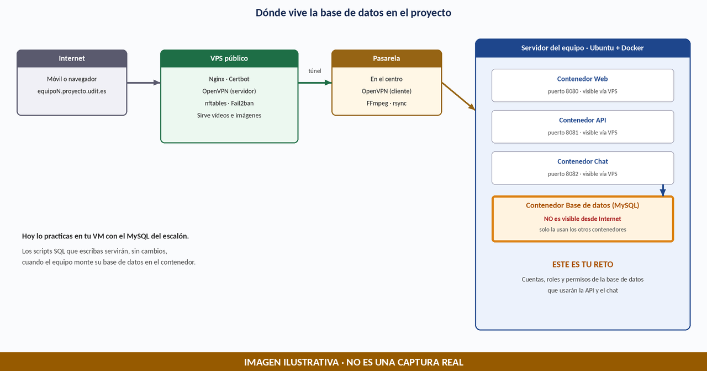
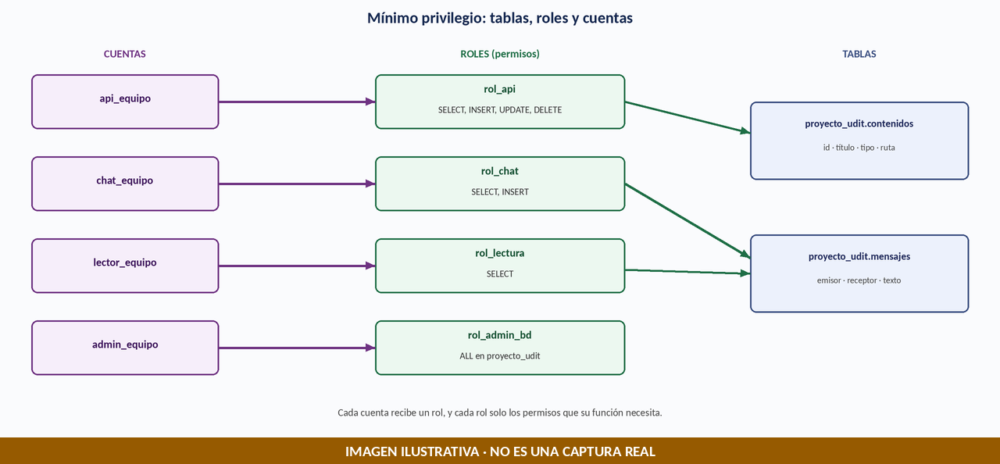
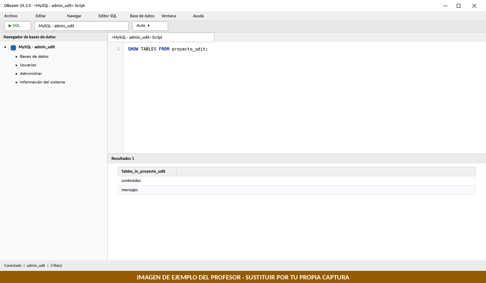
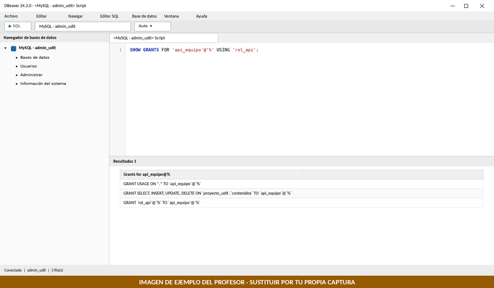
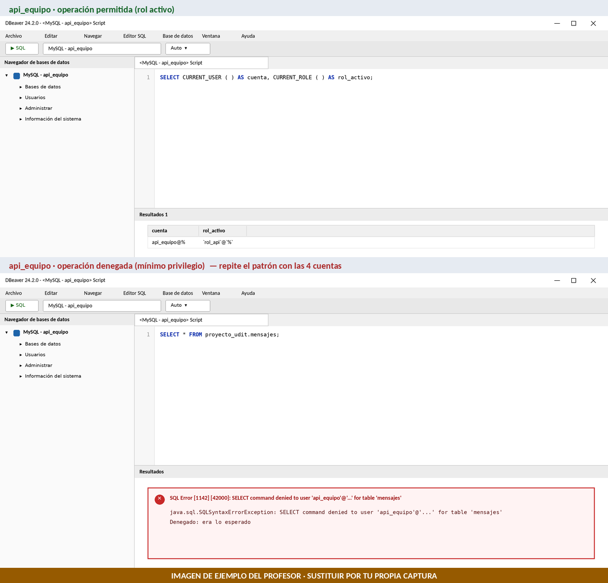
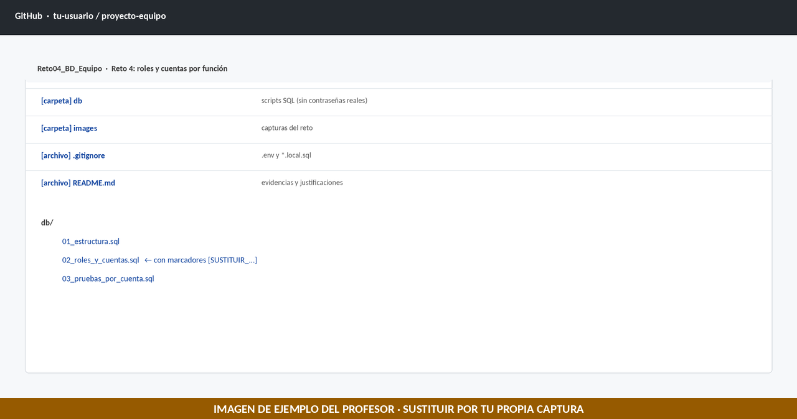

# Reto 4 (Evaluable) · La base de datos del equipo: roles y cuentas por función

> **Módulo:** 0377 · Administración de sistemas gestores de bases de datos (ASGBD) · 2.º ASIR · UDIT · curso 2026/27
> **Tipo:** Reto **evaluable individual**. Es tu aportación de ASGBD al **Sprint 1** del Proyecto Integrado.
> **Entorno:** tu VM Windows 11 con el MySQL 8.4 que instalaste en el escalón, y DBeaver en el PC físico.
> **Entrega:** GitHub (carpeta `Reto04_BD_Equipo/` con este `README.md`, los scripts SQL y las capturas).
> **Fecha límite:** domingo 22 de noviembre, 23:59.

## Metadatos del operador

| Campo | Valor |
|---|---|
| **Alumno/a** | _Nombre y apellidos_ |
| **Usuario de GitHub** | _@usuario_ |
| **Equipo del proyecto** | _Nº de equipo_ |
| **`<IP_SERVIDOR>` (tu VM)** | _Documenta tu valor real_ |
| **Fecha** | _dd/mm/aaaa_ |

---

## 1. Situación profesional

En el proyecto, cada equipo ejecuta su aplicación en un servidor del centro. La aplicación se divide en contenedores: web, API, chat y **base de datos**. La base de datos **no es visible desde Internet**: solo la usan los otros contenedores y el administrador.

Tu equipo todavía no tiene su servidor, pero necesita ya la **base de datos del equipo** preparada y bien protegida. Tu misión es escribir los **scripts SQL** que la crean y que dan a cada parte del proyecto una cuenta con **solo los permisos que necesita**: la API, el chat, un lector y un administrador.



Hoy lo practicas en tu VM, con el MySQL del escalón. Si los scripts están bien hechos, **servirán sin cambios** cuando el equipo monte su base de datos en el contenedor.

> **Importante:** el modelo de datos (tablas y campos) de este reto es **provisional**. El modelo definitivo lo acuerda 2.º DAM con los equipos. Lo que importa aquí es el **método**: roles, cuentas, mínimo privilegio y scripts reutilizables.

## 2. Qué producirás

1. **Scripts SQL** en GitHub: estructura, roles y cuentas, y pruebas.
2. **Cuatro cuentas** con roles de MySQL 8: `api_equipo`, `chat_equipo`, `lector_equipo` y `admin_equipo`.
3. **Pruebas** que demuestran qué puede y qué no puede hacer cada cuenta.
4. **Tres justificaciones técnicas** con tus palabras.



| Cuenta | Rol | Puede | No puede |
|---|---|---|---|
| `api_equipo` | `rol_api` | Leer, insertar, modificar y borrar en `contenidos` | Tocar `mensajes` ni crear objetos |
| `chat_equipo` | `rol_chat` | Leer e insertar en `mensajes` | Tocar `contenidos` |
| `lector_equipo` | `rol_lectura` | Leer todas las tablas de la base de datos | Modificar nada |
| `admin_equipo` | `rol_admin_bd` | Todo **dentro** de `proyecto_udit` | Administrar usuarios ni ver otras bases de datos |

## 3. Reglas de trabajo

- Trabaja con las conexiones del escalón. **No uses `root` en DBeaver.** Los scripts se ejecutan con `admin_udit`.
- **Nunca subas contraseñas a GitHub.** Los scripts se suben con los marcadores `[SUSTITUIR_...]`; los valores reales solo existen en tu copia local.
- Usa una **contraseña de laboratorio distinta para cada cuenta**, sin comillas simples (`'`) ni barras invertidas (`\`).
- Los scripts deben poder **ejecutarse más de una vez** sin errores.
- No borres ni cambies las cuentas `admin_udit` ni `usuario_restringido` del escalón.
- Las capturas deben ser **propias** y de pruebas **realmente ejecutadas**. No incluyas contraseñas en ellas.
- Si aparece un error que no está explicado aquí, copia el mensaje completo y consulta al profesor. No pruebes comandos al azar.
- En la **comprobación individual** (sin IA, 23-25 de noviembre) podrán pedirte que expliques y repitas tus scripts.

> En DBeaver: una sentencia con `Ctrl + Enter`; un script con varias sentencias con `Alt + X`.

## 4. Plan de trabajo

| Fecha | Qué haces |
|---|---|
| **Martes 10 de noviembre** | Partes A, B y C: comprobar el entorno, crear la estructura y las cuentas |
| **Martes 17 de noviembre** | Partes D, E y F: pruebas, GitHub y justificaciones. Revisión en clase |
| **Domingo 22 de noviembre** | Fecha límite de entrega |
| **23-25 de noviembre** | Comprobación individual sin IA |

---

## 5. Parte A · Comprobar el entorno

**Conexión:** `MySQL - admin_udit` (la del escalón).

1. Comprueba que la VM está encendida y el servicio de MySQL en marcha. En PowerShell de la VM:

   ```powershell
   Get-Service -Name "MySQL*"
   ```

   **Esperado:** `Running`.

2. En DBeaver, abre la conexión `MySQL - admin_udit` y ejecuta:

   ```sql
   SELECT CURRENT_USER() AS cuenta, VERSION() AS version;
   ```

   **Esperado:** `admin_udit@...` y una versión que empieza por `8.4`.

**Si no conecta:** repite las comprobaciones de red del escalón (`Test-NetConnection` al puerto 3306). Si sigue fallando, consulta al profesor.

## 6. Parte B · La estructura de la base de datos

**Conexión:** `MySQL - admin_udit`. Abre un editor SQL nuevo, pega el script y ejecútalo con `Alt + X`.

**Script `01_estructura.sql`:**

```sql
-- 01_estructura.sql · Base de datos del equipo (MySQL 8.4)
-- Se ejecuta como admin_udit. Se puede repetir sin errores.
-- MODELO PROVISIONAL: se adaptará al modelo de contenidos que acuerde 2.º DAM.

CREATE DATABASE IF NOT EXISTS proyecto_udit;

CREATE TABLE IF NOT EXISTS proyecto_udit.contenidos (
  id_contenido     VARCHAR(40)  PRIMARY KEY,
  titulo           VARCHAR(120) NOT NULL,
  tipo             VARCHAR(10)  NOT NULL CHECK (tipo IN ('VIDEO','COMIC','IMAGEN','JUEGO')),
  ruta_repositorio VARCHAR(255) NOT NULL,
  fecha_alta       TIMESTAMP    NOT NULL DEFAULT CURRENT_TIMESTAMP
);

CREATE TABLE IF NOT EXISTS proyecto_udit.mensajes (
  id_mensaje BIGINT       AUTO_INCREMENT PRIMARY KEY,
  emisor     VARCHAR(50)  NOT NULL,
  receptor   VARCHAR(50)  NOT NULL,
  texto      VARCHAR(500) NOT NULL,
  enviado_en TIMESTAMP    NOT NULL DEFAULT CURRENT_TIMESTAMP
);

-- Datos de prueba ficticios (INSERT IGNORE: si ya existen, no se duplican)
INSERT IGNORE INTO proyecto_udit.contenidos (id_contenido, titulo, tipo, ruta_repositorio) VALUES
  ('vid-0001', 'Video de prueba 1',  'VIDEO',  '/contenidos/videos/vid-0001/index.m3u8'),
  ('com-0001', 'Comic de prueba 1',  'COMIC',  '/contenidos/comics/com-0001/'),
  ('img-0001', 'Imagen de prueba 1', 'IMAGEN', '/contenidos/imagenes/img-0001.jpg');
```

| Sentencia | Qué hace |
|---|---|
| `CREATE DATABASE IF NOT EXISTS` | Crea la base de datos del proyecto, solo si no existe. |
| `CREATE TABLE IF NOT EXISTS ... contenidos` | Tabla de contenidos multimedia, con su identificador, título, tipo y ruta. |
| `CREATE TABLE IF NOT EXISTS ... mensajes` | Tabla de mensajes del chat. |
| `INSERT IGNORE INTO ...` | Añade tres contenidos ficticios; si ya existen, no los duplica. |

**Esperado:** sin errores. Comprueba el resultado:

```sql
SHOW TABLES FROM proyecto_udit;
```

**Esperado:** dos tablas, `contenidos` y `mensajes`.

📸 **Evidencia 1:** captura de `SHOW TABLES FROM proyecto_udit;` con el resultado.



## 7. Parte C · Roles y cuentas

**Conexión:** `MySQL - admin_udit`.

### C.1 Preparar tu copia local

1. Copia el script `02_roles_y_cuentas.sql` (más abajo) a un archivo **local** llamado `02_roles_y_cuentas.local.sql`. Ese archivo no se subirá a GitHub.
2. Sustituye cada marcador `[SUSTITUIR_CONTRASEÑA_...]` por una contraseña de laboratorio distinta, **conservando las comillas simples** que lo rodean. Puedes usar `Ctrl + F` (Reemplazar) en el editor de DBeaver.

**Script `02_roles_y_cuentas.sql`** (así se sube a GitHub, con los marcadores):

```sql
-- 02_roles_y_cuentas.sql · Roles y cuentas por función (MySQL 8.4)
-- Se ejecuta como admin_udit DESPUÉS de 01_estructura.sql.
-- IMPORTANTE: sustituye los marcadores [SUSTITUIR_...] solo en TU copia local.
-- En GitHub se sube SIEMPRE con los marcadores, nunca con contraseñas reales.

-- 1) Un rol por función
CREATE ROLE IF NOT EXISTS 'rol_api', 'rol_chat', 'rol_lectura', 'rol_admin_bd';

-- 2) Privilegios de cada rol: solo lo necesario
GRANT SELECT, INSERT, UPDATE, DELETE ON proyecto_udit.contenidos TO 'rol_api';
GRANT SELECT, INSERT ON proyecto_udit.mensajes TO 'rol_chat';
GRANT SELECT ON proyecto_udit.* TO 'rol_lectura';
GRANT ALL PRIVILEGES ON proyecto_udit.* TO 'rol_admin_bd';

-- 3) Una cuenta por función
CREATE USER IF NOT EXISTS 'api_equipo'@'%'    IDENTIFIED BY '[SUSTITUIR_CONTRASEÑA_API]';
CREATE USER IF NOT EXISTS 'chat_equipo'@'%'   IDENTIFIED BY '[SUSTITUIR_CONTRASEÑA_CHAT]';
CREATE USER IF NOT EXISTS 'lector_equipo'@'%' IDENTIFIED BY '[SUSTITUIR_CONTRASEÑA_LECTOR]';
CREATE USER IF NOT EXISTS 'admin_equipo'@'%'  IDENTIFIED BY '[SUSTITUIR_CONTRASEÑA_ADMIN]';

-- 4) Asignar cada rol a su cuenta
GRANT 'rol_api'       TO 'api_equipo'@'%';
GRANT 'rol_chat'      TO 'chat_equipo'@'%';
GRANT 'rol_lectura'   TO 'lector_equipo'@'%';
GRANT 'rol_admin_bd'  TO 'admin_equipo'@'%';

-- 5) Activar el rol al iniciar sesión (sin esto, la cuenta entra sin permisos)
SET DEFAULT ROLE 'rol_api'      TO 'api_equipo'@'%';
SET DEFAULT ROLE 'rol_chat'     TO 'chat_equipo'@'%';
SET DEFAULT ROLE 'rol_lectura'  TO 'lector_equipo'@'%';
SET DEFAULT ROLE 'rol_admin_bd' TO 'admin_equipo'@'%';

-- 6) Comprobar los privilegios de una cuenta a través de su rol
SHOW GRANTS FOR 'api_equipo'@'%' USING 'rol_api';
```

| Bloque | Qué hace |
|---|---|
| `CREATE ROLE` | Crea cuatro roles, uno por función. |
| `GRANT ... TO 'rol_...'` | Da a cada rol solo los permisos que su función necesita. |
| `CREATE USER ... @'%'` | Crea una cuenta por función. El host `'%'` se explica en la Parte F. |
| `GRANT 'rol_...' TO cuenta` | Asigna cada rol a su cuenta. |
| `SET DEFAULT ROLE` | Hace que el rol esté activo al iniciar sesión. Sin esto, la cuenta entra sin permisos. |
| `SHOW GRANTS ... USING` | Muestra los privilegios de una cuenta a través de su rol. |

### C.2 Ejecutar el script

Ejecuta **tu copia local** (con las contraseñas ya sustituidas) con `Alt + X`.

**Esperado:** sin errores y, al final, el resultado de `SHOW GRANTS` con tres líneas: `USAGE`, los permisos sobre `contenidos` y el rol `rol_api`.

📸 **Evidencia 2:** captura del resultado de `SHOW GRANTS FOR 'api_equipo'@'%' USING 'rol_api';`. No debe verse ninguna contraseña.



**Si aparece `Access denied; you need (at least one of) the ... privilege(s)`** al crear un rol o conceder un rol: avisa al profesor. Se resuelve ejecutando esa sentencia con `root` en el cliente `mysql` de la VM, pero no lo hagas por tu cuenta.

## 8. Parte D · Pruebas por cuenta

Cada cuenta se prueba con **su propia conexión** de DBeaver.

### D.1 Crear las cuatro conexiones

Para cada cuenta, crea una conexión como en el escalón (clic derecho sobre `MySQL - admin_udit` → copiar/pegar la conexión, y cambia el usuario y la contraseña):

| Nombre de la conexión | Usuario |
|---|---|
| `MySQL - api_equipo` | `api_equipo` |
| `MySQL - chat_equipo` | `chat_equipo` |
| `MySQL - lector_equipo` | `lector_equipo` |
| `MySQL - admin_equipo` | `admin_equipo` |

Deja el campo *Database* vacío. Si DBeaver pide `allowPublicKeyRetrieval`, aplica lo del escalón.

### D.2 Ejecutar las pruebas

Ejecuta cada sentencia **una a una** (`Ctrl + Enter`), con la conexión indicada. Antes de cada sentencia, mira qué conexión está activa.

**Script `03_pruebas_por_cuenta.sql`:**

```sql
-- 03_pruebas_por_cuenta.sql · Pruebas de permisos (MySQL 8.4)
-- Cada bloque se ejecuta con SU conexión de DBeaver. Una sentencia cada vez (Ctrl + Enter).

-- ===== Conexión: api_equipo =====
SELECT CURRENT_USER() AS cuenta, CURRENT_ROLE() AS rol_activo;                          -- rol_api activo
SELECT * FROM proyecto_udit.contenidos;                                                 -- permitido
INSERT INTO proyecto_udit.contenidos (id_contenido, titulo, tipo, ruta_repositorio)
  VALUES ('vid-9999', 'Prueba API', 'VIDEO', '/contenidos/videos/vid-9999/index.m3u8'); -- permitido
DELETE FROM proyecto_udit.contenidos WHERE id_contenido = 'vid-9999';                   -- permitido
SELECT * FROM proyecto_udit.mensajes;                                                   -- DENEGADO (error 1142)

-- ===== Conexión: chat_equipo =====
SELECT CURRENT_USER() AS cuenta, CURRENT_ROLE() AS rol_activo;                          -- rol_chat activo
INSERT INTO proyecto_udit.mensajes (emisor, receptor, texto)
  VALUES ('prueba_chat', 'prueba_chat', 'mensaje de prueba');                           -- permitido
SELECT * FROM proyecto_udit.mensajes;                                                   -- permitido
SELECT * FROM proyecto_udit.contenidos;                                                 -- DENEGADO (error 1142)

-- ===== Conexión: lector_equipo =====
SELECT CURRENT_USER() AS cuenta, CURRENT_ROLE() AS rol_activo;                          -- rol_lectura activo
SELECT * FROM proyecto_udit.contenidos;                                                 -- permitido
SELECT * FROM proyecto_udit.mensajes;                                                   -- permitido
INSERT INTO proyecto_udit.mensajes (emisor, receptor, texto)
  VALUES ('prueba_lector', 'prueba_lector', 'no debe poder');                           -- DENEGADO (error 1142)

-- ===== Conexión: admin_equipo =====
SELECT CURRENT_USER() AS cuenta, CURRENT_ROLE() AS rol_activo;                          -- rol_admin_bd activo
CREATE TABLE proyecto_udit.prueba_admin (id INT);                                       -- permitido
DROP TABLE proyecto_udit.prueba_admin;                                                  -- permitido
SELECT COUNT(*) FROM mysql.user;                                                        -- DENEGADO (error 1142)
```

| Cuenta | Debe funcionar | Debe fallar |
|---|---|---|
| `api_equipo` | Leer, insertar y borrar en `contenidos` | Leer `mensajes` (error `1142`) |
| `chat_equipo` | Insertar y leer en `mensajes` | Leer `contenidos` (error `1142`) |
| `lector_equipo` | Leer las dos tablas | Insertar en `mensajes` (error `1142`) |
| `admin_equipo` | Crear y borrar una tabla en `proyecto_udit` | Leer `mysql.user` (error `1142`) |

En todas, `CURRENT_ROLE()` debe mostrar el rol de la cuenta.

> Los errores `1142` (*command denied*) **son el resultado correcto**: demuestran que la cuenta está bien limitada.

**Si `CURRENT_ROLE()` sale `NONE`:** falta el `SET DEFAULT ROLE` de esa cuenta. Vuelve a ejecutar el bloque 5 del script 02 y **reconecta** esa conexión.

📸 **Evidencia 3:** composición de capturas, **una por cuenta**, que muestre para cada una una operación permitida y una denegada.



## 9. Parte E · Subir el trabajo a GitHub

Sube a tu repositorio esta estructura:

```text
Reto04_BD_Equipo/
├── README.md
├── .gitignore
├── db/
│   ├── 01_estructura.sql
│   ├── 02_roles_y_cuentas.sql      (con los marcadores, SIN contraseñas)
│   └── 03_pruebas_por_cuenta.sql
└── images/
    ├── evidencia_1_estructura.png
    ├── evidencia_2_permisos_roles.png
    ├── evidencia_3_pruebas_cuentas.png
    └── evidencia_4_repositorio.png
```

El archivo `.gitignore` debe contener estas dos líneas para que tu copia local con contraseñas no se suba:

```text
.env
*.local.sql
```

Haz un `commit` con un mensaje descriptivo, por ejemplo: `Reto 4: roles y cuentas por función de la base de datos`.

📸 **Evidencia 4:** captura de la carpeta del reto en GitHub, donde se vean los archivos `db/` y **sin ninguna contraseña real**.



## 10. Parte F · Justificación técnica

Responde con tus propias palabras. Relaciona las respuestas con lo que has hecho y observado.

**a)** Un vídeo del proyecto puede ocupar decenas de gigabytes. ¿Dónde se guarda ese vídeo y qué datos suyos guarda la base de datos? ¿Qué problema tendría guardarlo dentro de la base de datos?

> *[Redacta aquí tu justificación técnica con tus propias palabras]*

**b)** Las cuentas se han creado con host `'%'` y la base de datos no es visible desde Internet. ¿Qué protege el acceso en este caso? ¿En qué se diferencia de la cuenta `'usuario'@'IP'` del escalón?

> *[Redacta aquí tu justificación técnica con tus propias palabras]*

**c)** ¿Por qué se asignan los privilegios a roles y no directamente a cada cuenta? ¿Qué ocurre con una cuenta si falta `SET DEFAULT ROLE`?

> *[Redacta aquí tu justificación técnica con tus propias palabras]*

---

## 11. Plantilla para el equipo (opcional, no evaluable)

El ZIP incluye la carpeta `plantilla_equipo/` con los mismos scripts y un `docker-compose.yml` de partida. **No es un requisito del reto**: está sin probar y se usará cuando el equipo tenga su servidor, con el profesor. Sirve para que el equipo vea cómo los scripts de hoy se llevarían a un contenedor.

## 12. Criterios de evaluación

| Criterio | Puntuación |
|---|---|
| Estructura y datos de prueba: script `01` ejecutado y repetible (Evidencia 1) | 2 puntos |
| Roles y cuentas por función con mínimo privilegio (Evidencia 2) | 3 puntos |
| Pruebas por cuenta, permitidas y denegadas (Evidencia 3) | 2 puntos |
| Repositorio ordenado, sin contraseñas reales y con evidencias propias (Evidencia 4) | 1 punto |
| Justificaciones técnicas (Parte F) | 2 puntos |
| **Total** | **10 puntos** |

## 13. Errores frecuentes

| Error | Causa probable | Qué hacer |
|---|---|---|
| `ERROR 1064: You have an error in your SQL syntax` | Falta una coma o comilla, o quedó un marcador `[SUSTITUIR_...]` sin cambiar | Revisa la línea que indica el error |
| `ERROR 1396: Operation CREATE USER failed` | La cuenta ya existía con otro formato | No la repitas; avisa al profesor |
| `ERROR 1045: Access denied for user` al abrir una conexión | Contraseña errónea | Revisa la contraseña de esa cuenta en tu copia local |
| `ERROR 1142: ... command denied` en una prueba que **debía funcionar** | El rol no tiene el permiso, o el rol no está activo | Revisa los `GRANT` del rol y el `SET DEFAULT ROLE`; reconecta |
| `ERROR 1142` en una prueba que **debía fallar** | Es lo esperado | Es correcto: haz la captura |
| `CURRENT_ROLE()` devuelve `NONE` | Falta `SET DEFAULT ROLE` o no has reconectado | Repite el bloque 5 y reconecta |
| `ERROR 1050: table already exists` | Repetiste un `CREATE TABLE` sin `IF NOT EXISTS` | Usa los scripts tal cual: son repetibles |
| La subida a GitHub incluye contraseñas | Subiste tu copia local | Avisa al profesor **antes** de seguir; las contraseñas deben cambiarse |

## 14. Checklist final

- [ ] He comprobado el servicio y la conexión de `admin_udit`
- [ ] He ejecutado `01_estructura.sql` y veo las tablas `contenidos` y `mensajes`
- [ ] He ejecutado mi copia local de `02_roles_y_cuentas.sql`
- [ ] Las cuatro cuentas tienen su rol activo (`CURRENT_ROLE()`)
- [ ] He probado en cada cuenta una operación permitida y una denegada
- [ ] Las capturas son propias y no muestran contraseñas
- [ ] En GitHub hay `db/` con los scripts **con marcadores**, `.gitignore` y `images/`
- [ ] He respondido las tres justificaciones de la Parte F
- [ ] He entregado antes del domingo 22 de noviembre a las 23:59
