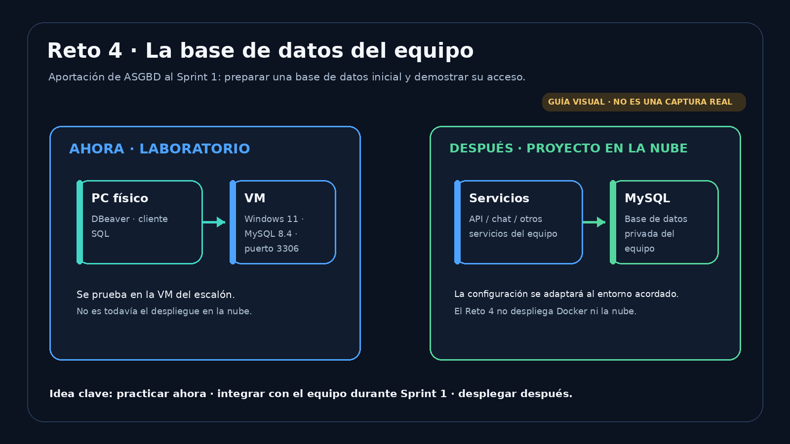
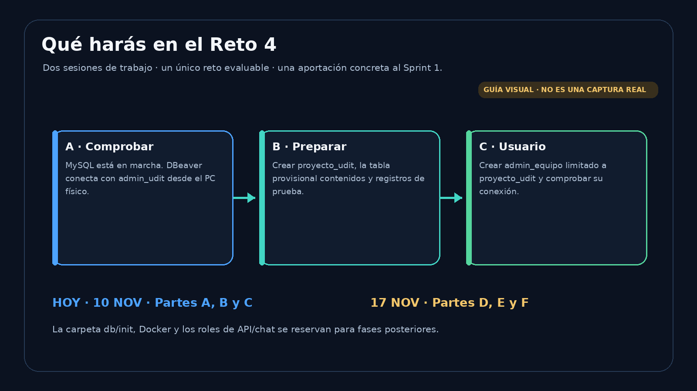
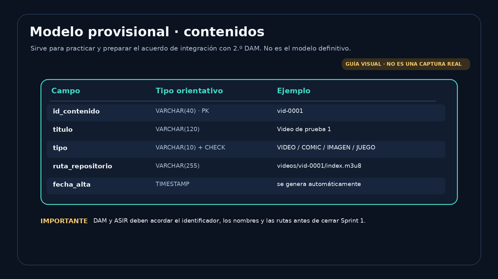

# Reto 4 (Evaluable) · Preparación inicial de la base de datos del equipo

> **Módulo:** 0377 · Administración de sistemas gestores de bases de datos (ASGBD) · 2.º ASIR · UDIT · curso 2026/27  
> **Proyecto:** Proyecto Integrado IT · contribución de ASGBD al **Sprint 1 · Arquitectura y base en la nube**  
> **Tipo:** reto evaluable individual, con un pequeño acuerdo de integración con el equipo DAM  
> **Entorno de práctica:** MySQL 8.4 en la VM Windows 11 del escalón anterior y DBeaver en el PC físico  
> **Entrega:** GitHub, carpeta `Reto04_BD_Equipo/`  
> **Fecha límite del reto:** domingo 22 de noviembre de 2026, 23:59

---

## Antes de empezar: qué estamos construyendo y para qué Sprint

Este reto es una aportación de ASGBD al **Sprint 1** del Proyecto Integrado. No pretende completar todo el Sprint ni desplegar todavía la base de datos definitiva en la nube.

La guía del Proyecto Integrado asigna a ASGBD en el Sprint 1 la instalación y configuración inicial de MySQL, la creación de una base de datos inicial, un usuario administrador y la comprobación de conexiones. También establece un punto de integración con DAM: compartir el identificador de contenido, los nombres y la estructura del repositorio.

En el **Sprint 2** se abordarán los roles y privilegios por función, la carga del modelo y los datos acordados con DAM, las copias de seguridad y la prueba de restauración. Por eso, en este Reto 4 todavía **no** crearás los cuatro roles de API/chat/lector/administrador, ni prepararás copias de seguridad.

### Qué harás ahora

1. Comprobar que MySQL 8.4 sigue funcionando y que `admin_udit` conecta desde DBeaver.
2. Crear una base de datos inicial llamada `proyecto_udit`.
3. Crear una tabla provisional `contenidos` con identificadores y rutas de ejemplo.
4. Crear una cuenta `admin_equipo` que administre **solo** `proyecto_udit`.
5. Comprobar que `admin_equipo` conecta desde el PC físico.

### Qué NO harás en este reto

- No instalarás Docker ni ejecutarás `docker compose`.
- No crearás todavía `db/init/`, `.env` ni `docker-compose.yml`.
- No desplegarás la base de datos en AWS o en un VPS.
- No programarás la API ni el chat.
- No crearás todavía `api_equipo`, `chat_equipo`, `lector_equipo` ni los roles correspondientes.
- No realizarás todavía las copias y restauraciones del Sprint 2.

La VM es el **laboratorio de práctica**. El SQL y la documentación que prepares serán la base que el equipo revisará y adaptará cuando se concrete el entorno de nube y el modelo de DAM.



## Metadatos del operador

| Campo | Valor |
|---|---|
| Alumno/a | _Nombre y apellidos_ |
| Usuario de GitHub | _@usuario_ |
| Equipo del Proyecto Integrado | _N.º de equipo_ |
| IP de la VM (servidor de laboratorio) | _IP real_ |
| IP del PC físico (cliente) | _IP real_ |
| Fecha | _dd/mm/2026_ |

## 1. Situación profesional

Cada equipo de ASIR y DAM debe preparar la infraestructura que permitirá que la aplicación de DAM utilice una base de datos común. La base de datos formará parte de la infraestructura del equipo; no debe publicarse directamente como un servicio web accesible desde Internet.

En esta primera fase no tenemos todavía que programar ni desplegar todos los servicios. Necesitamos una base de datos inicial, una cuenta administradora de esa base y una prueba de que se puede conectar desde un cliente.

La tabla `contenidos` es **provisional y didáctica**. Los ejemplos (`vid-0001`, `com-0001`, etc.) sirven para practicar. El formato definitivo del identificador, los nombres de los campos y las rutas deben acordarse con el subequipo de 2.º DAM antes de cerrar el Sprint 1.

## 2. Qué producirás

1. `01_estructura.sql`: crea `proyecto_udit`, la tabla provisional `contenidos` y datos ficticios.
2. `02_usuario_admin.sql`: crea `admin_equipo` y le concede permisos únicamente sobre `proyecto_udit`.
3. `03_pruebas_admin.sql`: reúne las comprobaciones de conexión y alcance de permisos.
4. Evidencias propias: estructura creada y conexión como `admin_equipo`.
5. `docs/acuerdo_integracion_sprint1.md`: registra los acuerdos o asuntos pendientes con DAM sobre identificadores y rutas.



## 3. Cuentas que utilizarás

| Cuenta | Procedencia | Uso en este reto |
|---|---|---|
| `root` | Instalación MySQL | No se usa en DBeaver ni en los scripts del reto. |
| `admin_udit` | Escalón MySQL | Cuenta administrativa del laboratorio; ejecuta los scripts. |
| `usuario_restringido` | Escalón MySQL | Cuenta de prueba sin permisos sobre `proyecto_udit`. |
| `admin_equipo` | Se crea en este reto | Administra los objetos de `proyecto_udit`, pero no administra usuarios ni el servidor MySQL. |

**No borres ni modifiques** `admin_udit` ni `usuario_restringido`.

La diferencia importante es esta:

- `admin_udit` es la cuenta administrativa global que preparaste en el escalón.
- `admin_equipo` será administrador **solo de la base de datos del proyecto**. No recibe `WITH GRANT OPTION` ni privilegios globales.

**Alcance de `admin_equipo`:** la cuenta que creas ahora está vinculada a la IP de tu PC físico para probarla en el laboratorio. No des por hecho que será la cuenta ni el host que utilizará el servidor en la nube. Cuando el equipo tenga definida la red y el despliegue, se decidirán las cuentas de administración y de servicio adecuadas para ese entorno.

## 4. Reglas de trabajo y seguridad

- Ejecuta los scripts de creación con la conexión `MySQL - admin_udit`.
- No uses `root` desde DBeaver.
- No subas contraseñas reales a GitHub.
- Para el laboratorio, crea una contraseña propia para `admin_equipo`. Evita comillas simples (`'`) y barras invertidas (`\`) en ella.
- Sustituye todos los marcadores `[SUSTITUIR_...]` en la copia local antes de ejecutarla. MySQL puede interpretar un marcador entre comillas como una contraseña literal; no confíes en que aparecerá un error de sintaxis.
- Sube a GitHub el archivo original con los marcadores, nunca la copia local.
- Las capturas deben ser propias y mostrar pruebas realmente ejecutadas. No deben mostrar contraseñas.
- No cambies la configuración de otros equipos ni pruebes conexiones contra servidores ajenos.

En DBeaver: una sentencia se ejecuta con `Ctrl + Enter`. Para ejecutar el contenido de un script con varias sentencias se utiliza `Alt + X`. En las pruebas de permisos, ejecuta las sentencias **una a una** y comprueba siempre la conexión activa.

## 5. Plan de trabajo

| Fecha | Partes | Resultado |
|---|---|---|
| **Martes 10 de noviembre** | A, B y C | Entorno comprobado, base de datos inicial creada y conexión de `admin_equipo` verificada. |
| **Martes 17 de noviembre** | D, E y F | Pruebas de permisos, GitHub, acuerdo con DAM y justificaciones. |
| **Domingo 22 de noviembre** | Entrega | Repositorio actualizado antes de las 23:59. |
| **23-25 de noviembre** | Comprobación individual | Explicar y repetir los comandos sin IA. |

El Sprint 1 del Proyecto Integrado termina el 27 de noviembre. Este reto es una parte de la contribución de ASGBD; la coordinación del equipo continúa hasta el cierre del Sprint.

---

# SESIÓN 1 · MARTES 10 DE NOVIEMBRE

## 6. Parte A · Comprobar el entorno

**Conexión:** `MySQL - admin_udit`, creada en el escalón anterior.

### A.1 Comprobar el servicio

En PowerShell de la VM Windows 11 ejecuta:

```powershell
Get-Service -Name "MySQL*"
```

**Esperado:** el servicio correspondiente a MySQL aparece como `Running`.

Si aparece `Stopped`, no continúes con SQL. Avisa al profesor y revisa el servicio.

### A.2 Comprobar la conexión desde DBeaver

Abre `MySQL - admin_udit` y ejecuta:

```sql
SELECT CURRENT_USER() AS cuenta, VERSION() AS version;
```

**Esperado:** aparece `admin_udit@...` y una versión que comienza por `8.4`.

Anota la IP que MySQL reconoce en el resultado de `CURRENT_USER()`. Es la IP que debes utilizar en el host de la cuenta nueva. No uses una IP de ejemplo.

Si no conecta, repite la prueba del escalón:

```powershell
Test-NetConnection -ComputerName <IP_SERVIDOR> -Port 3306
```

Sustituye `<IP_SERVIDOR>` por la IP real de la VM. Debe aparecer `TcpTestSucceeded : True`.

**Punto de control A:** MySQL está en `Running` y DBeaver conecta como `admin_udit`.

## 7. Parte B · Crear la base de datos inicial

**Conexión:** `MySQL - admin_udit`.

Abre un editor SQL nuevo y ejecuta el archivo `db/01_estructura.sql` con `Alt + X`.

El script realiza tres tareas:

1. Crea la base de datos `proyecto_udit`, si todavía no existe.
2. Crea la tabla provisional `contenidos`.
3. Inserta tres registros ficticios de ejemplo.

La tabla contiene:

| Campo | Función |
|---|---|
| `id_contenido` | Identificador único del contenido. |
| `titulo` | Nombre o título que se mostrará. |
| `tipo` | Tipo de contenido: VIDEO, COMIC, IMAGEN o JUEGO. |
| `ruta_repositorio` | Ruta relativa del fichero o carpeta en el repositorio. |
| `fecha_alta` | Fecha y hora de alta, generada por MySQL. |



### B.1 Comprobar las tablas

El script incluye esta consulta:

```sql
SHOW TABLES FROM proyecto_udit;
```

**Esperado:** una tabla llamada `contenidos`.

### B.2 Comprobar los registros

Ejecuta:

```sql
SELECT *
FROM proyecto_udit.contenidos
ORDER BY id_contenido;
```

**Esperado:** tres filas de prueba.

📸 **Evidencia 1 (hoy):** guarda una captura donde se vea la consulta y el resultado de `SELECT`, con las tres filas y las columnas. También debe poder identificarse la conexión utilizada. Nombre recomendado:

`capturas/01_estructura_y_datos.png`

**Punto de control B:** existe `proyecto_udit`, contiene `contenidos` y aparecen los tres registros.

### Qué debes entender

Los vídeos, cómics e imágenes no se guardan dentro de esta tabla. La base de datos guarda sus datos descriptivos y una ruta que permite localizar el fichero en el repositorio. La organización definitiva de esas rutas se acordará con DAM y con el bloque de contenidos del proyecto.

## 8. Parte C · Crear el administrador de la base de datos del equipo

**Conexión:** `MySQL - admin_udit`.

En este reto creas una cuenta propia del proyecto llamada `admin_equipo`. No es lo mismo que `admin_udit`.

- `admin_udit`: administra el servidor MySQL del laboratorio.
- `admin_equipo`: administra únicamente la base de datos `proyecto_udit`.

### C.1 Preparar una copia local del script

1. Abre `db/02_usuario_admin.sql`.
2. Guarda una copia local llamada `db/02_usuario_admin.local.sql`.
3. En esa copia sustituye los marcadores:
   - `[SUSTITUIR_IP_CLIENTE]`: por la IP del PC físico que MySQL reconoce en `CURRENT_USER()` al conectar como `admin_udit`.
   - `[SUSTITUIR_CONTRASENA_ADMIN]`: por una contraseña propia de laboratorio.
4. Comprueba con Buscar que no queda ningún texto `[SUSTITUIR_` en la copia local.

No elimines las comillas simples que rodean los valores.

### C.2 Entender las dos sentencias

```sql
CREATE USER IF NOT EXISTS 'admin_equipo'@'IP_REAL_DEL_CLIENTE'
IDENTIFIED BY 'CONTRASENA_LOCAL';

GRANT ALL PRIVILEGES ON proyecto_udit.*
TO 'admin_equipo'@'IP_REAL_DEL_CLIENTE';
```

- `CREATE USER`: crea una cuenta MySQL. La cuenta se identifica por usuario y host.
- `GRANT ALL PRIVILEGES ON proyecto_udit.*`: concede los privilegios disponibles sobre los objetos de `proyecto_udit`.
- No se concede `WITH GRANT OPTION`: `admin_equipo` no puede conceder esos privilegios a otras cuentas.
- No se conceden privilegios globales: la cuenta no administra todo el servidor ni las cuentas MySQL.

Ejecuta **tu copia local** de `02_usuario_admin.sql` con `Alt + X`, usando `MySQL - admin_udit`.

**Importante sobre `IF NOT EXISTS`:** si la cuenta exacta ya existe, MySQL no cambia automáticamente su contraseña. Si aparece un aviso de que `admin_equipo` ya existía, no supongas que la contraseña se ha actualizado: consulta al profesor.

### C.3 Crear la conexión de DBeaver

Crea una nueva conexión copiando `MySQL - admin_udit`:

| Campo | Valor |
|---|---|
| Nombre de conexión | `MySQL - admin_equipo` |
| Server Host | IP real de la VM |
| Port | `3306` |
| Database | Vacío |
| Username | `admin_equipo` |
| Password | La contraseña que acabas de establecer |

Pulsa **Test Connection**. Si conecta, guarda la conexión.

Abre un editor SQL asociado a `MySQL - admin_equipo` y ejecuta:

```sql
SELECT CURRENT_USER() AS cuenta, VERSION() AS version;
SHOW GRANTS;
```

**Esperado:** MySQL reconoce la cuenta `admin_equipo` y `SHOW GRANTS` muestra permisos sobre `proyecto_udit.*`, no privilegios globales de administración.

📸 **Evidencia 2 (hoy):** guarda una captura donde se vea `CURRENT_USER()` y `SHOW GRANTS` desde `MySQL - admin_equipo`. No debe verse la contraseña.

Nombre recomendado: `capturas/02_conexion_admin_equipo.png`

**Punto de control C:** `admin_equipo` conecta desde el PC físico y tiene permisos sobre `proyecto_udit`.

---

# SESIÓN 2 · MARTES 17 DE NOVIEMBRE

## 9. Parte D · Comprobar el alcance de las cuentas

Esta sesión demuestra que `admin_equipo` administra su base de datos, pero no el servidor MySQL.

Abre `db/03_pruebas_admin.sql`. Ejecuta cada sentencia individualmente (`Ctrl + Enter`) y cambia de conexión cuando lo indique el comentario.

### D.1 Con `MySQL - admin_equipo`

Estas operaciones deben funcionar:

```sql
SELECT * FROM proyecto_udit.contenidos;

CREATE TABLE proyecto_udit.comprobacion_admin (
    id INT PRIMARY KEY,
    nota VARCHAR(50) NOT NULL
);

DROP TABLE proyecto_udit.comprobacion_admin;
```

La primera consulta lee los contenidos. Las otras dos crean y eliminan una tabla de comprobación dentro de `proyecto_udit`.

Esta consulta debe fallar:

```sql
SELECT COUNT(*) FROM mysql.user;
```

**Esperado:** error `1142` de acceso denegado. Es correcto: `admin_equipo` no administra las cuentas ni tiene permisos de lectura sobre el esquema de sistema `mysql`.

### D.2 Con `MySQL - usuario_restringido`

Esta cuenta ya existe desde el escalón. Comprueba que sigue sin permisos sobre `proyecto_udit`:

```sql
SELECT CURRENT_USER();
SHOW GRANTS;

SELECT * FROM proyecto_udit.contenidos;
```

**Esperado:** la última consulta falla con error `1142`. No concedas permisos a esta cuenta en este reto.

📸 **Evidencia 3 (próxima semana):** captura de las pruebas permitidas y denegadas. Debe verse qué conexión está activa.

**Los errores de acceso denegado son resultados correctos cuando la prueba está diseñada para fallar.**

## 10. Parte E · GitHub y acuerdo de integración con DAM

### E.1 Estructura que subirás

```text
Reto04_BD_Equipo/
├── README.md
├── .gitignore
├── db/
│   ├── 01_estructura.sql
│   ├── 02_usuario_admin.sql
│   └── 03_pruebas_admin.sql
├── docs/
│   └── acuerdo_integracion_sprint1.md
├── images/
│   ├── 00_arquitectura_sprint1.png
│   ├── 01_flujo_reto4.png
│   ├── 02_modelo_contenidos.png
│   └── 03_sprint1_vs_sprint2.png
└── capturas/
    ├── 01_estructura_y_datos.png
    ├── 02_conexion_admin_equipo.png
    ├── 03_pruebas_permisos.png
    └── 04_repositorio_github.png
```

El `.gitignore` incluye:

```gitignore
.env
*.local.sql
```

Sube a GitHub los scripts originales con marcadores, nunca los archivos `.local.sql` con contraseñas reales.

Antes de hacer commit ejecuta:

```bash
git status
```

Comprueba que ningún archivo local con contraseñas está preparado para subirse.

📸 **Evidencia 4:** captura de la carpeta del reto en GitHub, con los scripts, documentación y evidencias, sin contraseñas.

### E.2 Hablar con el subequipo de DAM

El Sprint 1 tiene un punto de integración concreto: DAM y ASIR deben compartir:

- El mismo identificador de contenido.
- Los mismos nombres acordados.
- La misma estructura del repositorio de contenidos.

Reúnete con el subequipo de DAM de tu equipo y completa `docs/acuerdo_integracion_sprint1.md`.

En ese archivo registra:

1. Formato del identificador (`id_contenido`).
2. Tipos de contenido y sus nombres.
3. Nombre de los campos que intercambiarán DAM y la base de datos.
4. Estructura de carpetas y patrón de las rutas.
5. Responsables y fecha del acuerdo.

Los valores que aparecen en este reto son **ejemplos provisionales**, no decisiones oficiales. Si todavía no hay acuerdo, escribe `PENDIENTE` y anota quién debe resolverlo. No inventes acuerdos en nombre de DAM.

Este documento prepara el punto de integración del Sprint 1; el equipo debe cerrar los acuerdos antes del 27 de noviembre.

## 11. Parte F · Justificación técnica

Responde con tus propias palabras, relacionando las respuestas con las pruebas que has realizado.

**a)** ¿Qué diferencia hay entre `admin_udit` y `admin_equipo`? ¿Por qué es mejor que el administrador de la base de datos del proyecto no tenga privilegios globales?

**b)** ¿Por qué la base de datos almacena una ruta del contenido en lugar de guardar dentro de la tabla el fichero de vídeo o la imagen?

**c)** ¿Por qué el identificador y la ruta del contenido deben acordarse con DAM antes de cerrar la integración del Sprint 1?

---

## 12. Criterios de evaluación

| Criterio | Puntuación |
|---|---:|
| Comprobación del entorno y conexión con `admin_udit` (Parte A) | 1 punto |
| Creación de `proyecto_udit`, tabla y datos de prueba (Parte B) | 2,5 puntos |
| Creación de `admin_equipo` con alcance limitado y conexión desde DBeaver (Parte C) | 2,5 puntos |
| Pruebas de permisos permitidas y denegadas (Parte D) | 1 punto |
| Repositorio ordenado, scripts sin contraseñas y evidencias propias (Parte E) | 1 punto |
| Acuerdo o registro de pendientes de integración con DAM (Parte E) | 1 punto |
| Justificaciones técnicas (Parte F) | 1 punto |
| **TOTAL** | **10 puntos** |

## 13. Errores frecuentes

| Síntoma | Causa probable | Qué hacer |
|---|---|---|
| `Get-Service` no muestra MySQL en `Running` | Servicio detenido | No sigas con SQL; avisa al profesor y comprueba el servicio. |
| `TcpTestSucceeded : False` | Servicio, IP o firewall | Repite las comprobaciones del escalón para el puerto 3306. |
| Error `1045` al conectar como `admin_equipo` | Contraseña incorrecta o combinación usuario/host distinta | Revisa la contraseña local y que el host del usuario coincide con la IP cliente real. |
| Error `1130` | No existe una cuenta que permita conectar desde ese host | Comprueba la IP que devuelve `CURRENT_USER()` al conectar con `admin_udit`. |
| Error `1142` al consultar `proyecto_udit` con `admin_equipo` | No se aplicó correctamente el `GRANT` o se usó otra cuenta | Comprueba `SHOW GRANTS` desde `admin_equipo`. |
| Error `1142` al consultar `mysql.user` con `admin_equipo` | No tiene permisos sobre el esquema de sistema | Es el resultado esperado. |
| `CREATE USER IF NOT EXISTS` informa de que la cuenta ya existe | La cuenta ya estaba creada | No supone que su contraseña se haya actualizado. Consulta al profesor. |
| Quedan marcadores `[SUSTITUIR_...]` en el archivo local | No se sustituyeron todos los valores | Busca `[SUSTITUIR_` antes de ejecutar. |
| La copia local aparece en `git status` | El archivo no está siendo ignorado o ya estaba versionado | No hagas commit; revisa `.gitignore` y consulta al profesor. |

## 14. Checklist final

- [ ] MySQL 8.4 está instalado y el servicio aparece `Running`.
- [ ] DBeaver conecta como `admin_udit`.
- [ ] Existe la base de datos `proyecto_udit`.
- [ ] Existe la tabla `contenidos` con los registros de prueba.
- [ ] He creado `admin_equipo` con permisos solo sobre `proyecto_udit`.
- [ ] DBeaver conecta como `admin_equipo`.
- [ ] He comprobado qué operaciones están permitidas y cuáles denegadas.
- [ ] He completado o registrado como pendiente el acuerdo de integración con DAM.
- [ ] He subido los scripts públicos con marcadores, nunca las contraseñas.
- [ ] Las capturas son propias y muestran las pruebas reales.
- [ ] He respondido las justificaciones técnicas.
- [ ] He entregado antes del domingo 22 de noviembre de 2026 a las 23:59.

---

## 15. Referencias técnicas

Documentación oficial de MySQL 8.4:

- [CREATE DATABASE](https://dev.mysql.com/doc/refman/8.4/en/create-database.html)
- [CREATE TABLE y restricciones CHECK](https://dev.mysql.com/doc/refman/8.4/en/create-table.html)
- [CREATE USER](https://dev.mysql.com/doc/refman/8.4/en/create-user.html)
- [Nombres de cuentas: usuario y host](https://dev.mysql.com/doc/refman/8.4/en/account-names.html)
- [GRANT](https://dev.mysql.com/doc/refman/8.4/en/grant.html)

**Recuerda:** el objetivo del Reto 4 no es desplegar todo el proyecto. Es dejar una primera base de datos comprobable, documentada y lista para que el equipo continúe la integración del Sprint 1.
