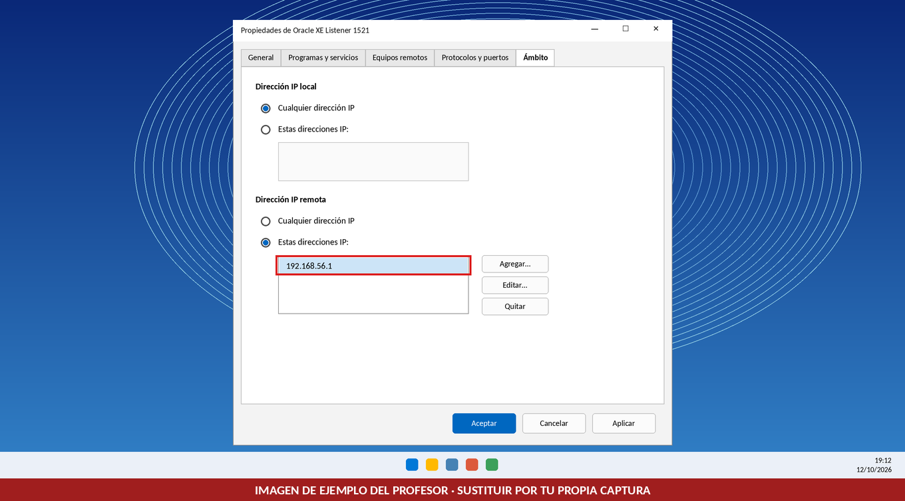
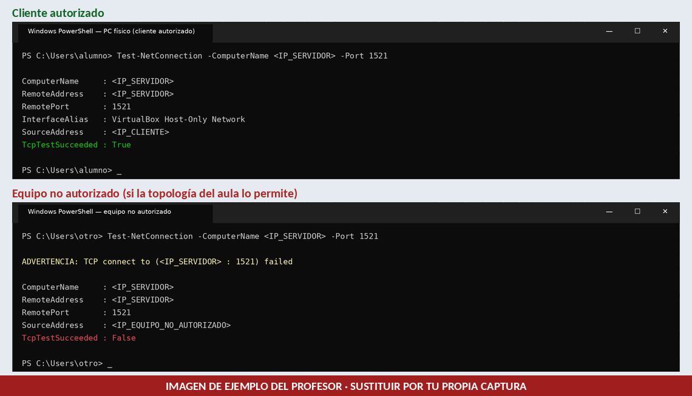
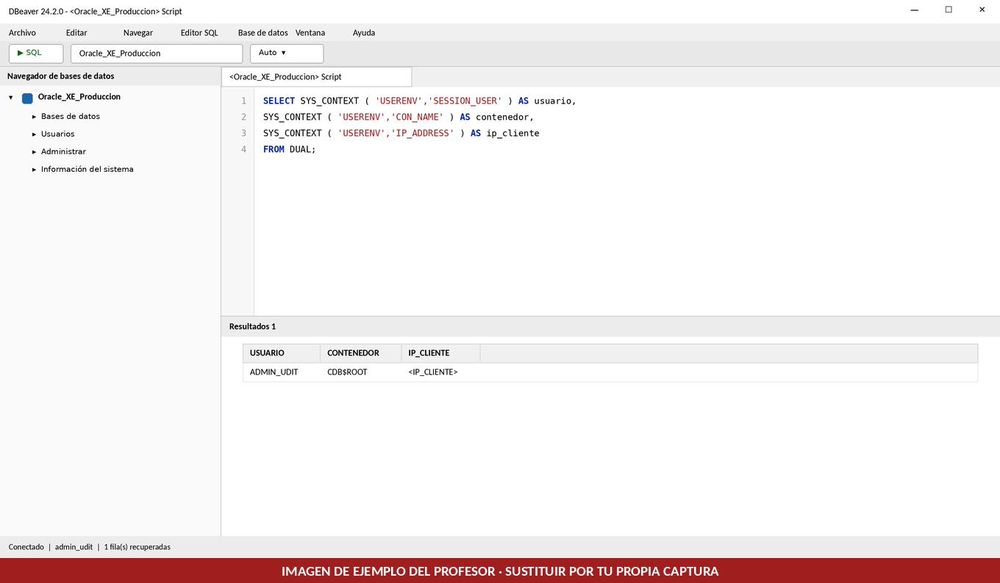
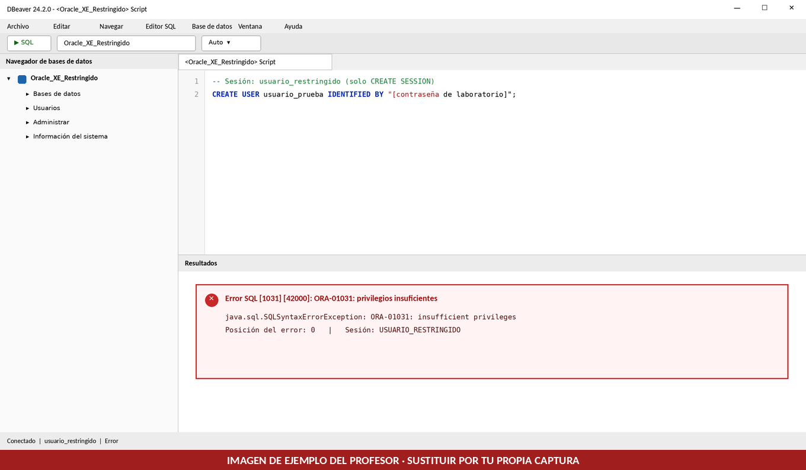

# Reto 2 (Evaluable) · Despliegue en Producción y Hardening

> **Módulo:** 0377 · Administración de Sistemas Gestores de Bases de Datos (ASGBD) · ASIR
> **Tipo:** Reto **evaluable**. Continuación del Laboratorio Base (Oracle Database 21c XE sobre Windows 11 en VirtualBox).
> **Documento:** Runbook de despliegue y hardening. Se versiona en Git; los cambios se auditan por *commit*.
> **Entrega:** exclusivamente en GitHub (commit de este `README.md` y de la carpeta `img/`).

## Metadatos del operador

| Campo | Valor |
|---|---|
| **Alumno/a** | _Nombre y apellidos_ |
| **Usuario de GitHub** | _@usuario_ |
| **IP del servidor (VM, Host-Only)** | _Documentar el valor real (`<IP_SERVIDOR>`)_ |
| **IP del cliente (PC físico, Host-Only)** | _Documentar el valor real (`<IP_CLIENTE>`)_ |
| **Service Name utilizado en DBeaver** | _Documentar el valor verificado_ |
| **Fecha** | _dd/mm/aaaa_ |

---

## 1. Objetivo

Pasar el entorno del Laboratorio Base a producción cerrando dos brechas de seguridad:

1. **Hardening perimetral:** la regla de entrada del puerto TCP 1521 pasa de aceptar cualquier origen a aceptar únicamente la IP del cliente autorizado.
2. **Mínimo privilegio:** se crea una cuenta de acceso restringido, `usuario_restringido`, que puede iniciar sesión pero no administrar usuarios ni modificar objetos.

**Requisitos previos (Laboratorio Base):** `OracleServiceXE` y el Listener en ejecución, regla `Oracle XE Listener 1521` creada y DBeaver instalado en el PC físico. `admin_udit` debe poder crear usuarios y conceder el privilegio de sistema `CREATE SESSION` en el contenedor donde se realizará la práctica; en el laboratorio base, esto se cumple si conserva el rol DBA o dispone de privilegios equivalentes.

### 1.1 Documentar las IP reales

No se proporcionan direcciones IP de referencia: cada alumno debe consultar y anotar las suyas en la tabla de metadatos.

| Equipo | Comando | Dato a anotar |
|---|---|---|
| VM (servidor) | `ipconfig` en PowerShell | IPv4 del adaptador Host-Only → `<IP_SERVIDOR>` |
| PC físico (cliente) | `ipconfig` en PowerShell | IPv4 del adaptador Host-Only de VirtualBox → `<IP_CLIENTE>` |

En el resto del documento, `<IP_SERVIDOR>` e `<IP_CLIENTE>` son marcadores que deben sustituirse por los valores reales anotados.

---

## 2. Fase 1 · Hardening del Firewall

La regla creada en el Laboratorio Base abre el puerto 1521 a cualquier origen. En producción debe ser restrictiva.

En la **VM**:

1. `Win + R` → `wf.msc` (*Firewall de Windows Defender con seguridad avanzada*).
2. **Reglas de entrada** → doble clic en `Oracle XE Listener 1521` → **Propiedades**.
3. Pestaña **Ámbito** → sección *Dirección IP remota* → **Estas direcciones IP** → **Agregar…**
4. Introducir `<IP_CLIENTE>` y confirmar con **Aplicar** y **Aceptar**.

Equivalente por PowerShell (como administrador):

```powershell
# Sustituye la dirección por la IP real de tu PC físico (192.168.56.1 es solo un ejemplo de formato)
$IP_CLIENTE = "192.168.56.1"

Set-NetFirewallRule -DisplayName "Oracle XE Listener 1521" -RemoteAddress $IP_CLIENTE

Get-NetFirewallRule -DisplayName "Oracle XE Listener 1521" |
    Get-NetFirewallAddressFilter
```

> El valor de `$IP_CLIENTE` debe coincidir con la IP anotada en la tabla de metadatos. No ejecutes el bloque sin sustituirla.

📸 **Evidencia 1:** pestaña **Ámbito** mostrando la IP autorizada.



---

## 3. Fase 2 · Conectividad y validación

### 3.1 Comprobaciones previas

Antes de interpretar cualquier resultado negativo, verificar en la **VM** que el servicio y el Listener están activos:

```powershell
Get-Service -Name OracleServiceXE
Get-Service | Where-Object { $_.Name -like "*TNSListener*" }
lsnrctl status
```

### 3.2 Validación TCP desde el cliente autorizado

Desde el **PC físico**, define la IP real del servidor y ejecuta la prueba:

```powershell
# Sustituye la dirección por la IP real de la VM (ejemplo de formato: 192.168.56.10)
$IP_SERVIDOR = "192.168.56.10"

Test-NetConnection -ComputerName $IP_SERVIDOR -Port 1521
```

> Sustituye `192.168.56.10` por el valor de `<IP_SERVIDOR>` anotado en la tabla de metadatos. No ejecutes el bloque con la dirección de ejemplo.

| Resultado | Interpretación |
|---|---|
| `TcpTestSucceeded : True` | Se ha establecido la conexión TCP con el puerto 1521 del servidor. |
| `TcpTestSucceeded : False` | La conexión TCP no se ha establecido. **Por sí solo no demuestra que la causa sea el firewall**: también puede deberse a un Listener detenido, una IP errónea o un problema de red. |

El cliente autorizado debe obtener `True` antes de continuar. Si obtiene `False`, revisar las comprobaciones previas y la IP configurada en el Ámbito.

### 3.3 Prueba desde un equipo no autorizado

El objetivo es demostrar que la regla restringe el acceso TCP al puerto 1521 a la IP autorizada.

- Esta prueba solo es válida si existe **conectividad real** entre ambos equipos y la topología del aula lo permite. Dos ordenadores físicos no comparten automáticamente una red Host-Only de VirtualBox.
- Solo se interpreta el resultado negativo si antes se ha comprobado que el Listener está activo y que el cliente autorizado conecta (`True`).
- Si no hay un segundo equipo accesible, **comunícalo al profesor** y sigue el método alternativo de validación que autorice. No se deben simular resultados ni presentar pruebas no realizadas.

Ejecutar en el equipo no autorizado el mismo comando de 3.2.

Cada evidencia demuestra algo distinto y no son equivalentes:

| Evidencia | Qué demuestra | Qué no demuestra |
|---|---|---|
| Pestaña **Ámbito** (Evidencia 1) | La regla está configurada con la IP autorizada | Que el acceso funcione ni que se bloquee a otros |
| `True` desde el cliente autorizado (Evidencia 2) | El cliente autorizado alcanza el puerto 1521 | Que otros orígenes queden bloqueados |
| `False` desde un origen no autorizado (Evidencia 2) | Bloqueo comprobado, **solo si** el Listener está activo y el cliente autorizado conecta | Nada concluyente si faltan esas comprobaciones |

Si la prueba desde un segundo equipo no es posible y el profesor ha confirmado que la infraestructura no lo permite, el alumno que siga la alternativa autorizada **no se penaliza** por ello.

📸 **Evidencia 2:** captura (o composición de capturas) de la consola con el `Test-NetConnection` exitoso del cliente autorizado y, cuando sea técnicamente posible, el resultado negativo del equipo no autorizado.



### 3.4 Conexión con DBeaver como `admin_udit`

| Parámetro | Valor |
|---|---|
| **Host** | `<IP_SERVIDOR>` |
| **Puerto** | `1521` |
| **Service Name** | El verificado en el Laboratorio Base |
| **Usuario** | `admin_udit` |

Comprobar la sesión y el contenedor activo:

```sql
SELECT SYS_CONTEXT('USERENV','SESSION_USER') AS usuario,
       SYS_CONTEXT('USERENV','CON_NAME')     AS contenedor
FROM DUAL;
```

📸 **Evidencia 3:** DBeaver conectado desde el cliente autorizado como `admin_udit`.



---

## 4. Fase 3 · Principio de mínimo privilegio

### 4.1 Cuenta de acceso restringido

`usuario_restringido` es una **cuenta de acceso restringido**: puede iniciar sesión, pero no tiene permisos para administrar usuarios ni modificar objetos.

> `GRANT CREATE SESSION` permite **iniciar sesión**. No concede automáticamente permisos de lectura sobre tablas.

### 4.2 Nota técnica: contenedor y `_ORACLE_SCRIPT`

- `ALTER SESSION SET "_ORACLE_SCRIPT" = TRUE` es un recurso interno de Oracle y **no es un procedimiento habitual de administración**. Se conserva en este reto únicamente como **excepción didáctica**, por continuidad con el Laboratorio Base (`admin_udit` se creó en el contenedor raíz). **No debe trasladarse a un entorno de producción real.**
- En una instalación multitenant, la práctica recomendada para crear un usuario local es trabajar en la **PDB** correspondiente (por ejemplo, `XEPDB1` si existe en esa instalación).
- No des por hecho que `XEPDB1` existe: verifica el contenedor activo y las PDB disponibles.

```sql
SELECT SYS_CONTEXT('USERENV','CON_NAME') AS contenedor_actual FROM DUAL;
SELECT NAME, OPEN_MODE FROM V$PDBS;
```

Anota el contenedor y el Service Name verificados en la tabla de metadatos. **Todo el script de 4.3 debe ejecutarse en un único contexto de conexión**; no mezcles sentencias pensadas para `CDB$ROOT` con otras pensadas para una PDB.

### 4.3 Crear `usuario_restringido`

Conectado como `admin_udit`:

```sql
ALTER SESSION SET "_ORACLE_SCRIPT" = TRUE;  -- excepción didáctica del laboratorio; no usar en producción (ver 4.2)

CREATE USER usuario_restringido IDENTIFIED BY "[SUSTITUIR_POR_UNA_CONTRASEÑA_SEGURA]";
GRANT CREATE SESSION TO usuario_restringido;

SELECT USERNAME, ACCOUNT_STATUS, CREATED
  FROM DBA_USERS
 WHERE USERNAME = 'USUARIO_RESTRINGIDO';
```

> 🔐 **Sustituye `[SUSTITUIR_POR_UNA_CONTRASEÑA_SEGURA]` antes de ejecutar el script.** Usa una contraseña exclusiva de laboratorio: no reutilices credenciales personales o institucionales y no publiques contraseñas reales en GitHub.

### 4.4 Demostrar el aislamiento

1. Crear una nueva conexión en DBeaver con `usuario_restringido`.
2. Intentar crear otro usuario (con una contraseña de laboratorio):

```sql
CREATE USER usuario_prueba IDENTIFIED BY "[SUSTITUIR_POR_UNA_CONTRASEÑA_SEGURA]";
```

Debe aparecer `ORA-01031: insufficient privileges`.

📸 **Evidencia 4:** composición de dos capturas que demuestre ambos puntos:

1. Como `admin_udit`, ejecutar la consulta siguiente y mostrar que `USUARIO_RESTRINGIDO` existe y tiene el estado `OPEN`:

   ```sql
   SELECT USERNAME, ACCOUNT_STATUS
     FROM DBA_USERS
    WHERE USERNAME = 'USUARIO_RESTRINGIDO';
   ```

2. Como `usuario_restringido`, mostrar el error `ORA-01031: insufficient privileges` al intentar crear `usuario_prueba`.

Une ambas capturas en una sola imagen, sin ocultar el nombre de la cuenta, el estado ni el error. No inventes ni simules resultados; ambas pruebas deben haberse ejecutado realmente.



---

## 5. Fase 4 · Justificación técnica

**a)** ¿Qué diferencia existe entre un cierre ordenado de Oracle y una caída inesperada? Explica el efecto sobre las transacciones sin confirmar y la recuperación posterior.

> *[Redacta aquí tu justificación técnica con tus propias palabras]*

**b)** ¿Qué diferencia hay entre que el firewall descarte una conexión TCP y que el Listener esté detenido? ¿Qué prueba utilizarías para distinguir ambas situaciones?

> *[Redacta aquí tu justificación técnica con tus propias palabras]*

**c)** ¿Qué permiso le falta al usuario restringido para crear otro usuario? ¿Por qué es peligroso utilizar una cuenta con privilegios administrativos para todas las tareas?

> *[Redacta aquí tu justificación técnica con tus propias palabras]*

---

## 6. Criterios de evaluación

| Criterio | Puntuación |
|---|---|
| Restricción del firewall y validación de conectividad (Evidencias 1, 2 y 3) | 3 puntos |
| Creación del usuario restringido y demostración de privilegios (Evidencia 4) | 3 puntos |
| Evidencias propias y correctamente documentadas | 2 puntos |
| Justificaciones técnicas de la Fase 4 | 2 puntos |
| **Total** | **10 puntos** |

La prueba desde un equipo no autorizado no penaliza al alumno cuando el profesor haya confirmado que la infraestructura no permite realizarla y el alumno haya seguido la alternativa autorizada.

---

## 7. Checklist de evidencias

- [ ] **Evidencia 1:** pestaña **Ámbito** del Firewall con la IP autorizada
- [ ] **Evidencia 2:** `Test-NetConnection` exitoso del cliente autorizado y, cuando sea técnicamente posible, resultado negativo del equipo no autorizado (o método alternativo autorizado por el profesor)
- [ ] **Evidencia 3:** DBeaver conectado desde el cliente autorizado como `admin_udit`
- [ ] **Evidencia 4:** composición con `USUARIO_RESTRINGIDO` en estado `OPEN` (consulta como `admin_udit`) y error `ORA-01031` al intentar crear otro usuario con `usuario_restringido`
- [ ] Fase 4: tres justificaciones redactadas

**Condiciones de las evidencias**

- Las capturas deben ser **propias** y corresponder a las pruebas **realmente ejecutadas**.
- Las imágenes de `img/` incluidas con este documento son ejemplos del profesor y no contienen credenciales. **Debes sustituirlas por tus propias capturas** conservando el nombre de archivo; entregar las imágenes de ejemplo no cuenta como evidencia.
- Antes del commit, comprueba que `img/` está incluida en el repositorio y que existen los cuatro archivos con los nombres exactos de la estructura inferior.
- No incluyas contraseñas ni otros secretos en las capturas.
- Guarda las capturas en `img/`, haz `git commit` con un mensaje descriptivo (por ejemplo, `Reto 2: hardening firewall y usuario restringido`) y entrega el enlace en la plataforma.

---

## Estructura del repositorio

```text
Reto_2_Produccion_Hardening/
├── README.md
└── img/
    ├── evidencia_1_ambito_firewall.png
    ├── evidencia_2_test_netconnection.png
    ├── evidencia_3_dbeaver_admin.png
    └── evidencia_4_ora01031.png
```
