# Escalón MySQL: instalar, conectar y probar tu primer caso

| | |
|---|---|
| **Módulo** | 0377 · Administración de sistemas gestores de bases de datos |
| **Ciclo y curso** | 2.º ASIR · UDIT · curso 2026/27 |
| **Carácter** | **No evaluable** (práctica guiada, sin nota) |
| **Duración** | 3 horas (180 min) |
| **Entorno** | **La misma VM Windows 11 del Reto 2 y del Reto 3** (donde ya está Oracle) y DBeaver en tu PC físico |
| **Objetivo** | Dejar MySQL instalado y conectado para que el **Reto 4 de la semana próxima** (evaluable) no te dé ningún problema técnico |

> **Sobre las imágenes.** Todas las imágenes de `images/` son **ilustrativas**: no son capturas reales. Sirven para que sepas qué esperar. Tu pantalla puede diferir (versión de MySQL, de DBeaver, nombres de servicio, direcciones IP). Todas llevan la indicación "Imagen ilustrativa".
>
> **Los datos de ejemplo** (como `192.168.56.101` o `192.168.56.1`) **no son los tuyos**: usa siempre los valores reales de tu VM y de tu PC.

---

## 1. Qué vas a conseguir

Al terminar la sesión tendrás:

1. MySQL 8.4 instalado como servicio en tu VM, junto a Oracle.
2. La cuenta `root` asegurada y solo para uso local.
3. Dos cuentas nuevas, con los mismos nombres que en Oracle: `admin_udit` y `usuario_restringido`.
4. Una regla de firewall que abre el puerto **3306** únicamente a la IP de tu PC físico.
5. DBeaver conectado desde el PC físico al MySQL de la VM.
6. Un primer caso resuelto: base de datos, tabla, vista y permiso `SELECT` solo sobre la vista (el mismo planteamiento del Reto 3, ahora en MySQL).

Este documento **no resuelve el Reto 4**: solo te deja el entorno listo y practicado.

## 2. Mapa de la sesión

| Minutos | Bloque | Qué haces |
|---|---|---|
| 0-15 | Arranque | Comprobaciones previas (sección 4) |
| 15-25 | Conceptos | Qué cambia de Oracle a MySQL (sección 5) |
| 25-60 | **Parte 1** | Instalar MySQL en la VM (sección 6) |
| 60-80 | **Parte 2** | Cliente local y creación de cuentas (sección 7) |
| 80-100 | **Parte 3** | Firewall y prueba de red (sección 8) |
| 100-110 | Descanso | 10 minutos |
| 110-135 | **Parte 4** | Conectar DBeaver (sección 9) |
| 135-165 | **Parte 5** | Primer caso: tabla, vista y permiso (sección 10) |
| 165-180 | Cierre | Comparativa Oracle y MySQL, dudas y checklist (secciones 11-13) |

> **Regla de oro:** no pases a la siguiente parte hasta superar el **punto de control** de la actual. Si un punto de control falla, mira la tabla de errores (sección 12) y avisa al profesor.

---

## 3. Dos reglas para trabajar sin errores

- **Cada bloque de código va en el sitio que se indica**: unos en **PowerShell** de la VM, otros en el cliente **`mysql`** de la VM y otros en **DBeaver** del PC físico. Si pegas un comando en el sitio equivocado, dará error.
- **Los textos entre `<` y `>`, o entre `[` y `]`, son marcadores:** hay que sustituirlos (incluidos los propios signos `<>` o `[]`) por tu valor real **antes** de ejecutar.

---

## 4. Antes de empezar (0-15 min)

### 4.1 Lo que necesitas

| Elemento | Dónde | ¿Listo? |
|---|---|---|
| VM Windows 11 encendida, con Oracle del Reto 2 | VirtualBox | ☐ |
| Una cuenta de **administrador de Windows** en la VM (la misma con la que instalaste Oracle) | VM | ☐ |
| El instalador **MySQL Community Server 8.4 LTS (MSI de Windows, 64 bits)** que facilita el profesor | VM | ☐ |
| DBeaver instalado en el PC físico | PC físico | ☐ |
| Espacio libre en disco: al menos 3 GB | VM | ☐ |

### 4.2 Anota tus direcciones IP

En la **VM**, abre PowerShell (`Win + X` → *Terminal* o *Windows PowerShell*) y ejecuta:

```powershell
Get-NetIPAddress -AddressFamily IPv4 | Select-Object InterfaceAlias, IPAddress
```

| Qué hace |
|---|
| Muestra las direcciones IPv4 de cada adaptador de red de la VM. |

Busca la dirección del adaptador **Host-Only**, la misma red que usaste en el Reto 2 (suele empezar por `192.168.56.`). **No uses la del adaptador NAT** (suele empezar por `10.0.2.`). Esa es tu **`<IP_SERVIDOR>`**.

En el **PC físico**, ejecuta lo mismo y anota la IP del adaptador Host-Only de VirtualBox. Esa es tu **`<IP_CLIENTE>`**.

| Dato | Mi valor real |
|---|---|
| `<IP_SERVIDOR>` (VM) | _anótala aquí_ |
| `<IP_CLIENTE>` (PC físico) | _anótala aquí_ |

> Comprueba que las dos IP empiezan igual en sus tres primeros números (por ejemplo `192.168.56.`). Si no, avisa al profesor.

### 4.3 Comprueba la memoria de la VM

Con Oracle y MySQL a la vez, la VM necesita memoria libre. Abre el **Administrador de tareas** de la VM (`Ctrl + Shift + Esc`) → pestaña **Rendimiento** → **Memoria**.

- **Si "Disponible" es de 1 GB o más:** continúa.
- **Si es menor de 1 GB:** para Oracle durante la práctica (en PowerShell como administrador) y lo reinicias al final:

  ```powershell
  Stop-Service -Name OracleServiceXE
  ```

  Para volver a iniciarlo después: `Start-Service -Name OracleServiceXE`.

### 4.4 Haz una instantánea de seguridad

Es tu red de seguridad: si algo sale mal, puedes volver a este punto. En **VirtualBox** (en el PC físico): selecciona tu VM → **Instantáneas** (*Snapshots*) → **Tomar** → ponle un nombre como `antes_de_MySQL`.

✅ **Punto de control 0:** tienes anotadas `<IP_SERVIDOR>` e `<IP_CLIENTE>`, hay memoria libre y has hecho la instantánea.

---

## 5. Conceptos en diez minutos (15-25 min)

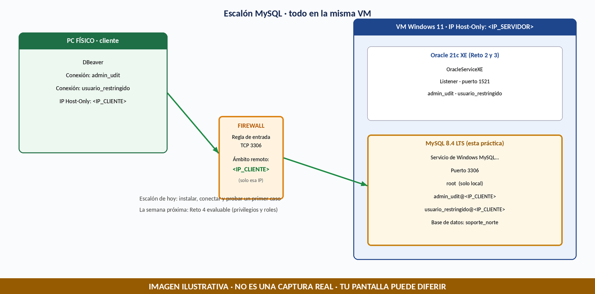

| Concepto | Oracle (lo que ya conoces) | MySQL (lo nuevo) |
|---|---|---|
| Puerto | 1521 | **3306** |
| Servicio de Windows | `OracleServiceXE` | Uno propio de MySQL (algo como `MySQL84`) |
| Administrador local | `SYSTEM` | **`root`** (solo para uso local) |
| Contenedor raíz y PDB | Sí (`CDB$ROOT`, `XEPDB1`) | **No existen** |
| `_ORACLE_SCRIPT` | Se usaba como excepción didáctica | **No existe ni hace falta** |
| Sinónimos | Sí | **No existen** |
| Una cuenta es... | `usuario` | **`usuario@host`**: el usuario **y** desde dónde puede conectar |

**La idea nueva más importante:** en MySQL una cuenta se identifica por **usuario + host**. `'admin_udit'@'192.168.56.1'` solo puede conectar **desde** esa IP. Es un segundo nivel de protección, además del firewall.

> **Importante:** los usuarios de Oracle (`admin_udit`, `usuario_restringido`) **solo existen dentro de Oracle**. MySQL tiene su propia lista de usuarios, vacía al empezar. Por eso hoy se **crean de nuevo** con los mismos nombres.

---

## 6. Parte 1 · Instalar MySQL en la VM (25-60 min)

**Dónde:** en la **VM**, con tu cuenta de administrador de Windows.

> **Qué es `root`:** es el administrador de MySQL, como `SYSTEM` en Oracle. Se usa solo en la VM, para crear cuentas. **Nunca** se usa a diario ni desde DBeaver.

### 6.1 Ejecutar el instalador

1. Copia el instalador MSI a la VM (por la carpeta compartida o el medio que indique el profesor).
2. Haz doble clic sobre el archivo `mysql-8.4.x-winx64.msi` (la parte `x` depende de la versión).
3. Si Windows pregunta *¿Quieres permitir que esta aplicación haga cambios?*, pulsa **Sí**.
4. Si el instalador indica que falta **Microsoft Visual C++ Redistributable**, instálalo primero (te lo facilita el profesor) y vuelve a ejecutar el MSI.
5. En el asistente: acepta la licencia, elige la instalación **Typical** (o la opción estándar) y deja la carpeta de instalación por defecto. Pulsa **Install**.
6. Al terminar, deja marcada la opción que **inicia el configurador** (*MySQL Configurator*) y pulsa **Finish**.

### 6.2 Configurar MySQL (MySQL Configurator)

El configurador te lleva por varias pantallas. Los nombres pueden variar un poco según la versión. **Si aparece una pantalla que no se menciona aquí, deja sus valores por defecto y pulsa Next.**

**Pantalla 1 · Type and Networking**

| Campo | Qué poner |
|---|---|
| Config Type | **Development Computer** (es el que menos memoria usa) |
| TCP/IP | Marcada, puerto **3306** |
| X Protocol Port | 33060 (no lo toques) |
| Named Pipe y Shared Memory | Desmarcadas |
| **Open Windows Firewall ports for network access** | **DESMARCADA** (si aparece). El puerto lo abrirás tú, solo para tu IP, en la Parte 3 |

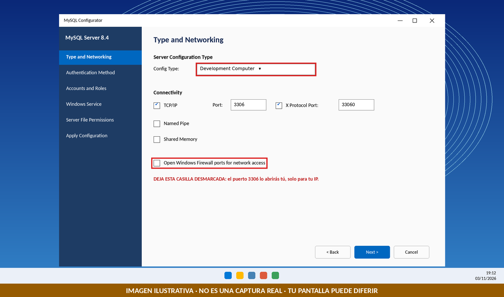

**Pantalla 2 · Authentication Method**

Deja la opción recomendada (*Use Strong Password Encryption for Authentication*).

**Pantalla 3 · Accounts and Roles**

Escribe la contraseña de **`root`** y repítela. Elige una **contraseña de laboratorio, guárdala bien y no la escribas en capturas ni en GitHub.** No añadas ningún usuario en esta pantalla.

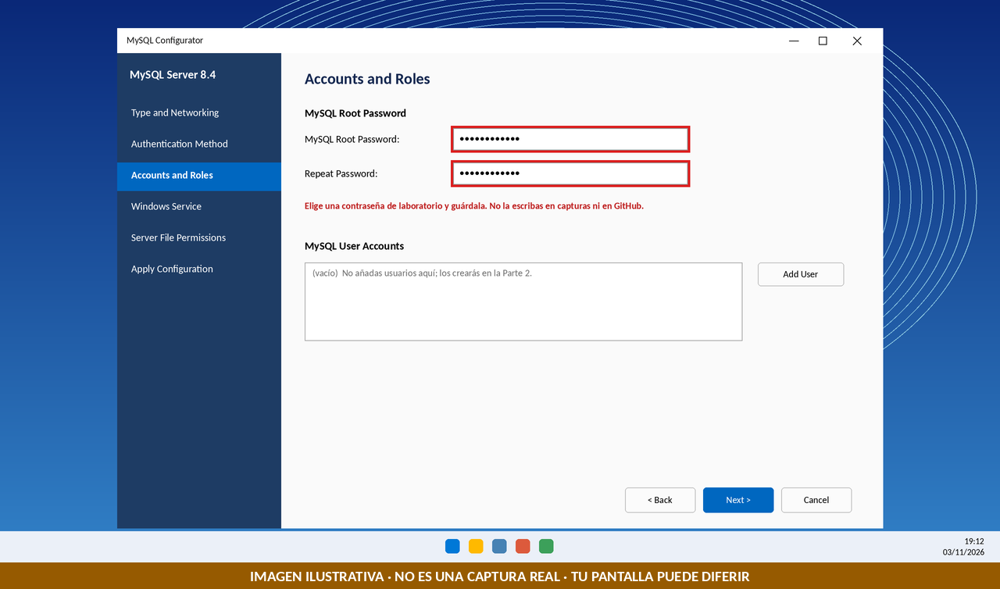

**Pantalla 4 · Windows Service**

| Campo | Qué poner |
|---|---|
| Configure MySQL Server as a Windows Service | Marcada |
| Windows Service Name | El valor por defecto (algo como `MySQL84`). **Anota cómo se llama el tuyo** |
| Start the MySQL Server at System Startup | Marcada |
| Run Windows Service as | Standard System Account |

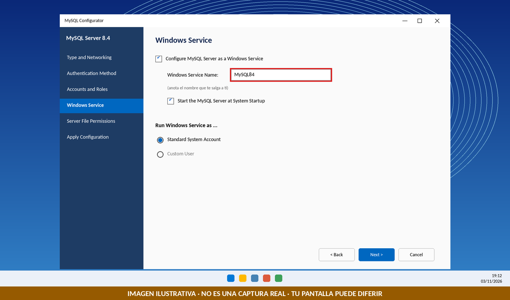

**Pantalla 5 · Server File Permissions** (si aparece): deja los valores por defecto.

**Pantalla 6 · Apply Configuration**

Pulsa **Execute** y espera. Todos los pasos deben quedar marcados como correctos. Pulsa **Finish**.

### 6.3 Comprobar que el servicio está en marcha

En PowerShell de la VM:

```powershell
Get-Service -Name "MySQL*"
```

| Qué hace |
|---|
| Busca los servicios de Windows cuyo nombre empieza por `MySQL` y muestra su estado. |

**Resultado esperado:** una línea con `Status` = `Running`.

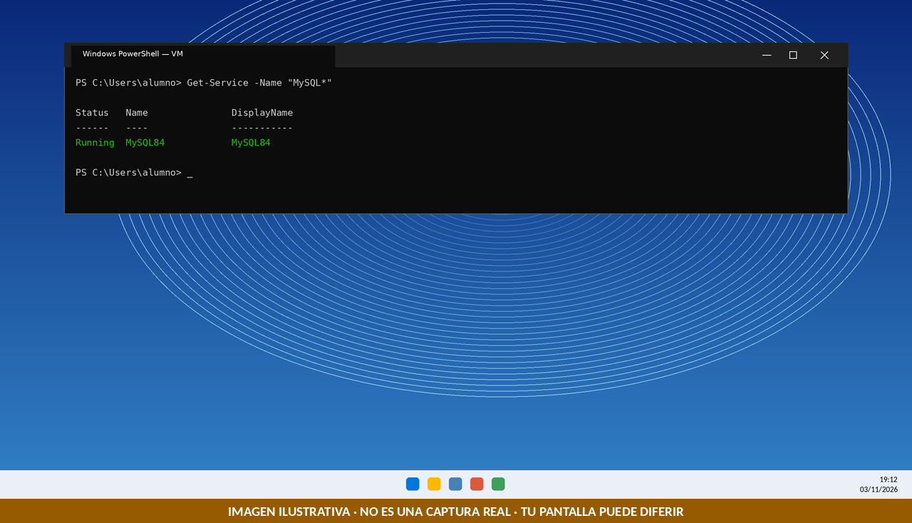

**Si sale `Stopped`:** inícialo con `Start-Service -Name "<nombre_del_servicio>"` (sustituye por el nombre que te ha salido). Si no arranca, consulta la sección 12.

✅ **Punto de control 1:** `Get-Service -Name "MySQL*"` muestra el servicio en `Running`.

---

## 7. Parte 2 · Cliente local y creación de cuentas (60-80 min)

**Dónde:** en la **VM**. `root` solo puede conectar desde la propia VM, así que las cuentas se crean aquí.

### 7.1 Abrir el cliente `mysql` como `root`

En PowerShell de la VM, comprueba primero que el programa existe:

```powershell
Test-Path "C:\Program Files\MySQL\MySQL Server 8.4\bin\mysql.exe"
```

**Esperado:** `True`. Si sale `False`, busca la carpeta real con `Get-ChildItem "C:\Program Files\MySQL"` y usa ese nombre en lugar de `MySQL Server 8.4`.

Abre el cliente:

```powershell
& "C:\Program Files\MySQL\MySQL Server 8.4\bin\mysql.exe" -u root -p
```

| Parte | Qué hace |
|---|---|
| `&` | Ejecuta el programa indicado entre comillas |
| `-u root` | Conecta con el usuario `root` |
| `-p` | Pide la contraseña (al escribirla no se ve nada; es normal) |

Escribe la contraseña de `root` y pulsa **Intro**. El indicador debe cambiar a `mysql>`.

### 7.2 Comprobar que MySQL responde

Escribe en el prompt `mysql>`:

```sql
SELECT VERSION();
SHOW DATABASES;
```

**Esperado:** una versión que empieza por `8.4`, y cuatro bases de datos: `information_schema`, `mysql`, `performance_schema` y `sys`.

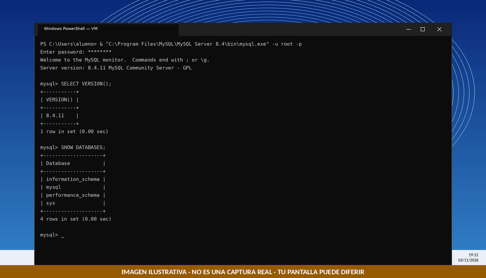

✅ **Punto de control 2:** `SELECT VERSION();` responde.

### 7.3 Preparar el script de cuentas (en el Bloc de notas)

Para no cometer errores, **no escribas esto directamente**. Abre el **Bloc de notas** de la VM y pega:

```sql
CREATE USER 'admin_udit'@'<IP_CLIENTE>' IDENTIFIED BY '[SUSTITUIR_POR_UNA_CONTRASEÑA_SEGURA]';
GRANT ALL PRIVILEGES ON *.* TO 'admin_udit'@'<IP_CLIENTE>' WITH GRANT OPTION;
CREATE USER 'usuario_restringido'@'<IP_CLIENTE>' IDENTIFIED BY '[SUSTITUIR_POR_UNA_CONTRASEÑA_SEGURA]';
```

Ahora sustituye, **con el Bloc de notas** (`Ctrl + H`, Reemplazar):

1. `<IP_CLIENTE>` → tu IP real del PC físico (en las 3 apariciones), **sin** `<` ni `>` y **conservando las comillas simples**.
2. Cada `[SUSTITUIR_POR_UNA_CONTRASEÑA_SEGURA]` → una contraseña de laboratorio **distinta para cada cuenta**, sin comillas simples (`'`) ni barras invertidas (`\`) dentro.

Cada línea debe quedar así (con tus valores):

```text
CREATE USER 'admin_udit'@'192.168.56.1' IDENTIFIED BY 'tu contraseña de laboratorio';
```

(`192.168.56.1` es solo un ejemplo del formato: pon **tu** IP y **tu** contraseña, siempre entre comillas simples.)

| Sentencia | Qué hace |
|---|---|
| `CREATE USER 'admin_udit'@'IP' IDENTIFIED BY '...'` | Crea la cuenta del administrador del laboratorio, que solo podrá conectar desde esa IP. |
| `GRANT ALL PRIVILEGES ON *.* TO ... WITH GRANT OPTION` | Le da todos los privilegios (equivale al rol DBA de Oracle). Es mucho poder: solo para este laboratorio. |
| `CREATE USER 'usuario_restringido'@'IP' ...` | Crea la cuenta restringida **sin ningún privilegio**: solo podrá conectarse. |

### 7.4 Ejecutar el script

1. Selecciona todo el texto del Bloc de notas (`Ctrl + A`) y cópialo (`Ctrl + C`).
2. Pégalo en la ventana de PowerShell donde tienes el prompt `mysql>` (clic derecho suele pegar).
3. Pulsa **Intro** si hace falta.

**Esperado:** tres veces `Query OK, 0 rows affected`.

### 7.5 Verificar las cuentas

```sql
SELECT user, host FROM mysql.user WHERE user IN ('admin_udit','usuario_restringido');
```

**Esperado:** dos filas, con tu `<IP_CLIENTE>` en la columna `host`.

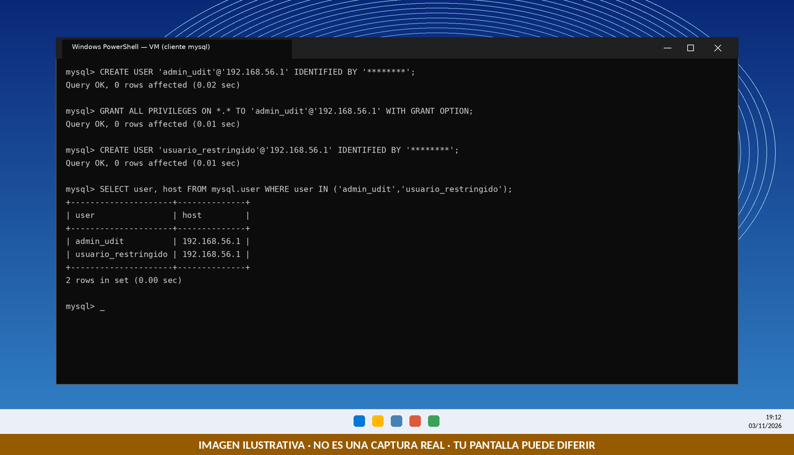

Para salir del cliente: `exit`

✅ **Punto de control 3:** ves las dos cuentas con tu IP en la columna `host`.

> **Si te equivocas con una cuenta** (IP mal escrita, por ejemplo): avisa al profesor antes de borrar nada. El borrado correcto sería `DROP USER 'usuario'@'host_equivocado';` y repetir ese `CREATE USER`.

---

## 8. Parte 3 · Firewall y prueba de red (80-100 min)

### 8.1 Primera prueba: el 3306 sigue cerrado

**Dónde:** PowerShell del **PC físico**.

```powershell
# Sustituye la dirección por la IP real de tu VM
$IP_SERVIDOR = "192.168.56.101"

Test-NetConnection -ComputerName $IP_SERVIDOR -Port 3306
```

| Qué hace |
|---|
| Comprueba si el puerto TCP 3306 de la VM acepta conexiones. |

**Resultado esperado ahora: `TcpTestSucceeded : False`.** Es normal: Windows bloquea por defecto las conexiones entrantes. Todavía no has abierto el puerto. (Antes de la regla, `False` no demuestra por sí solo que el firewall sea la causa; aquí lo sabes porque el servicio está en marcha y no has creado la regla.)

### 8.2 Revisar si ya existe alguna regla del 3306

**Dónde:** PowerShell de la **VM**, como administrador.

```powershell
Get-NetFirewallPortFilter -Protocol TCP | Where-Object { $_.LocalPort -eq '3306' } | Get-NetFirewallRule | Select-Object DisplayName, Enabled, Direction, Action
```

| Qué hace |
|---|
| Lista las reglas del firewall que afectan al puerto TCP 3306. |

- **Si no sale nada:** continúa en 8.3.
- **Si sale alguna regla (por ejemplo, creada por el instalador):** **no crees otra.** Avisa al profesor: hay que restringir esa regla a tu IP, o una regla abierta a todo anularía tu restricción.

### 8.3 Crear la regla restringida a tu IP

**Dónde:** en la **VM**. Opción **A (gráfica, como en el Reto 2)**:

1. `Win + R` → `wf.msc` → **Reglas de entrada** → **Nueva regla…**
2. Tipo: **Puerto** → **TCP** → Puertos locales específicos: `3306`.
3. Acción: **Permitir la conexión**. Perfil: marca los tres (Dominio, Privado y Público).
4. Nombre: `MySQL 3306`.
5. Abre las **Propiedades** de la regla → pestaña **Ámbito** → en *Dirección IP remota* marca **Estas direcciones IP** → **Agregar…** → escribe tu `<IP_CLIENTE>` → **Aceptar**.

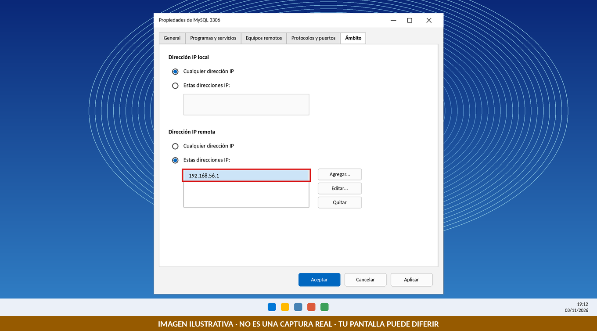

Opción **B (PowerShell como administrador)**:

```powershell
# Sustituye la dirección por la IP real de tu PC físico
$IP_CLIENTE = "192.168.56.1"

New-NetFirewallRule -DisplayName "MySQL 3306" -Direction Inbound -Protocol TCP -LocalPort 3306 -Action Allow -RemoteAddress $IP_CLIENTE
```

| Qué hace |
|---|
| Crea una regla de entrada que permite el puerto 3306 **solo** desde la IP indicada. |

### 8.4 Segunda prueba: ahora debe abrir

**Dónde:** PowerShell del **PC físico**.

```powershell
Test-NetConnection -ComputerName $IP_SERVIDOR -Port 3306
```

**Esperado: `TcpTestSucceeded : True`.**

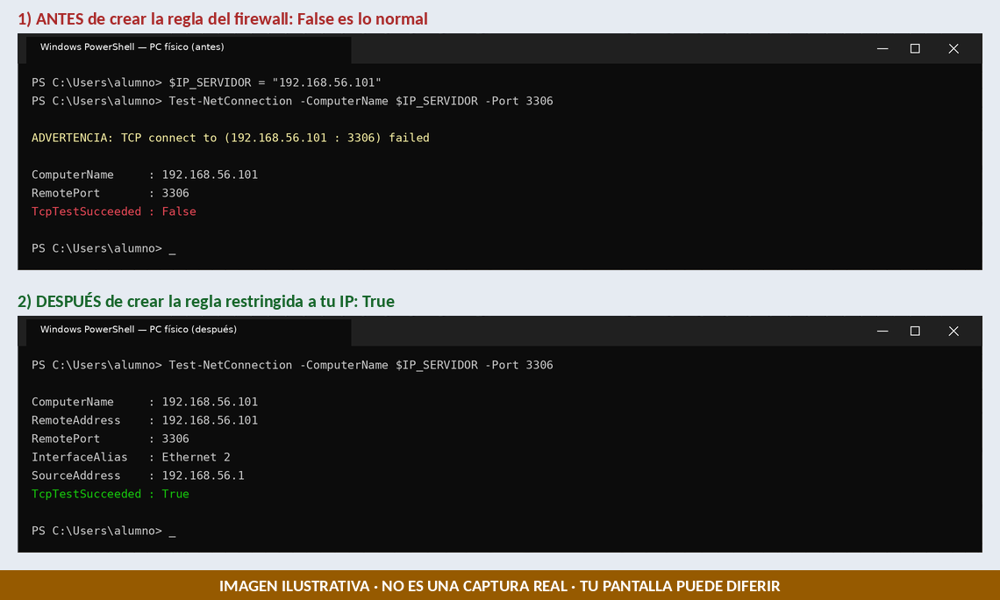

**Si sigue en `False`:** comprueba por este orden: (1) el servicio MySQL está `Running`; (2) `$IP_SERVIDOR` es la de la VM en la red Host-Only; (3) la IP del Ámbito es la de tu PC físico; (4) no hay otra regla que lo contradiga.

✅ **Punto de control 4:** `TcpTestSucceeded : True` desde el PC físico.

---

## 9. Parte 4 · Conectar DBeaver (110-135 min)

**Dónde:** DBeaver en el **PC físico**. Necesita **internet** la primera vez, para descargar el driver de MySQL.

### 9.1 Crear la conexión de `admin_udit`

1. En DBeaver: **Base de datos** → **Nueva conexión** (o el icono de enchufe con un +).
2. Elige **MySQL** y pulsa **Siguiente**.
3. Rellena la pestaña **Main**:

   | Campo | Valor |
   |---|---|
   | Server Host | `<IP_SERVIDOR>` (la IP de la VM) |
   | Port | `3306` |
   | Database | **déjalo vacío** |
   | Authentication | Database Native |
   | Username | `admin_udit` |
   | Password | la contraseña que pusiste a `admin_udit` |

   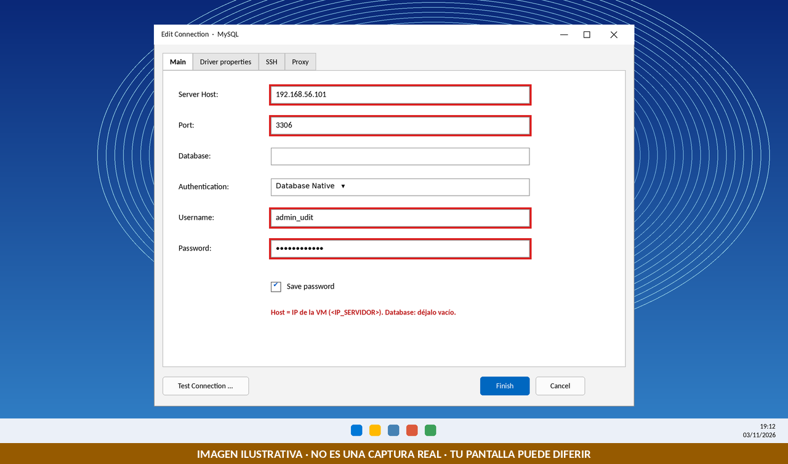

4. Pulsa **Test Connection**. Si DBeaver pide descargar el driver, pulsa **Download** y espera.
5. Si el resultado es **Connected**, pulsa **Finish**.
6. Cambia el nombre de la conexión a `MySQL - admin_udit` (clic derecho → *Rename*; tecla `F2`).

**Si aparece `Public Key Retrieval is not allowed`:** en el mismo diálogo abre **Driver properties**, busca `allowPublicKeyRetrieval`, pon su valor en `true` y vuelve a probar.

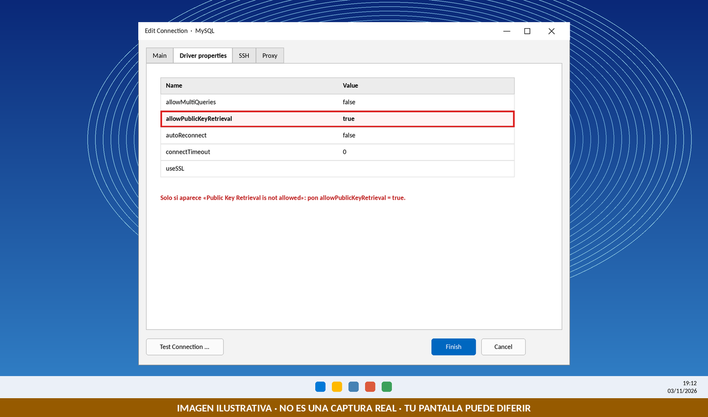

### 9.2 Comprobar la sesión

Abre un editor SQL (clic derecho sobre la conexión → **Editor SQL** → **Nuevo script**, o `Ctrl + ]`) y ejecuta con `Ctrl + Enter`:

```sql
SELECT CURRENT_USER() AS cuenta, VERSION() AS version, @@port AS puerto;
```

| Qué hace |
|---|
| Muestra la cuenta con la que has entrado, la versión de MySQL y el puerto. |

**Esperado:** `admin_udit@<tu IP>`, versión `8.4.x` y puerto `3306`.

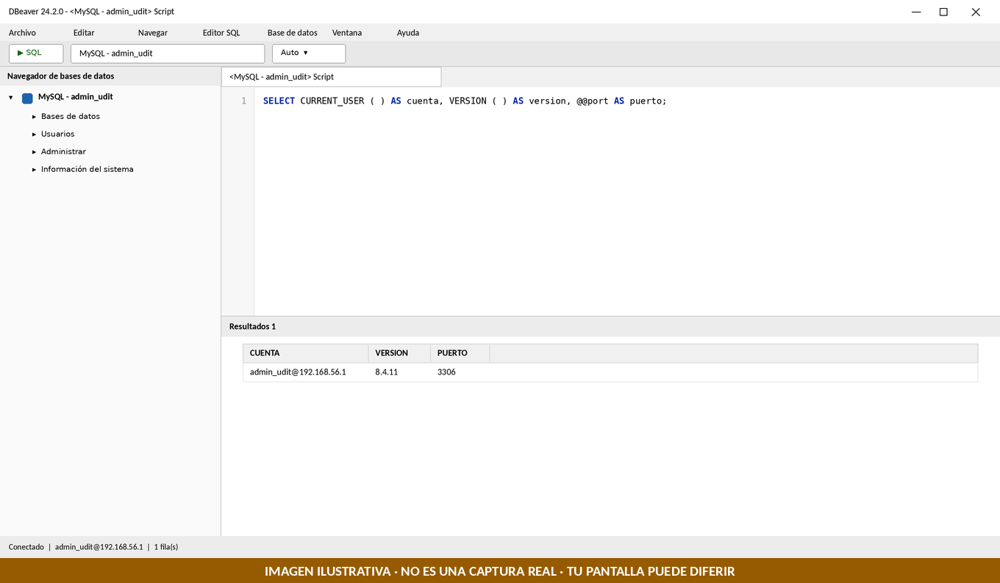

> **Apunta la parte de la derecha de `cuenta`** (tu IP tal como la ve MySQL): es el valor exacto de `<IP_CLIENTE>` que debes usar en los `GRANT`.

### 9.3 Crear la conexión de `usuario_restringido`

Repite el apartado 9.1 con estos cambios: **Username** = `usuario_restringido`, su contraseña, y nombre de conexión `MySQL - usuario_restringido`. Comprueba con:

```sql
SELECT CURRENT_USER();
```

**Esperado:** `usuario_restringido@<tu IP>`.

✅ **Punto de control 5:** las dos conexiones de DBeaver funcionan y devuelven la cuenta correcta.

> **Cuidado:** antes de ejecutar cualquier sentencia, mira **la conexión activa** (arriba, en la barra de herramientas del editor). Una sentencia lanzada con la cuenta equivocada es el error más frecuente.

---

## 10. Parte 5 · Primer caso: tabla, vista y permiso (135-165 min)

Es el mismo caso del Reto 3 (incidencias de soporte), ahora en MySQL. Usas datos ficticios.

> **Cómo ejecutar:** una sola sentencia con `Ctrl + Enter`; varias sentencias seguidas (un *script*) con `Alt + X`.

### 10.1 Crear la base de datos y la tabla

**Usuario:** `admin_udit` (conexión `MySQL - admin_udit`).

```sql
CREATE DATABASE soporte_norte;

CREATE TABLE soporte_norte.incidencias (
  id_incidencia INT PRIMARY KEY,
  cliente VARCHAR(50) NOT NULL,
  email_contacto VARCHAR(80),
  asunto VARCHAR(80) NOT NULL,
  estado VARCHAR(15) NOT NULL,
  prioridad VARCHAR(10) NOT NULL
);
```

| Sentencia | Qué hace |
|---|---|
| `CREATE DATABASE soporte_norte` | Crea la base de datos (en MySQL, base de datos y esquema son lo mismo). |
| `CREATE TABLE soporte_norte.incidencias (...)` | Crea la tabla dentro de esa base de datos, con clave primaria y campos obligatorios. |

**Esperado:** sin errores.

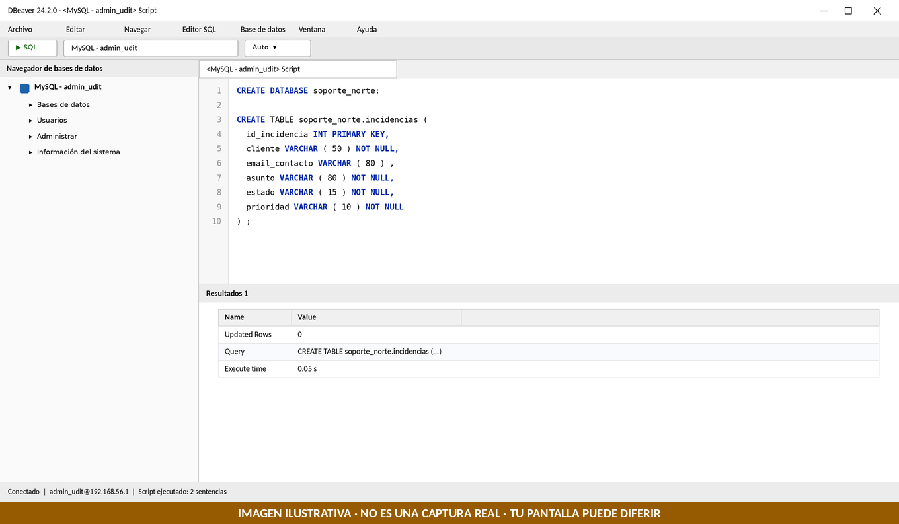

### 10.2 Insertar cinco incidencias ficticias

**Usuario:** `admin_udit`. Ejecuta con `Alt + X`:

```sql
INSERT INTO soporte_norte.incidencias (id_incidencia, cliente, email_contacto, asunto, estado, prioridad) VALUES
 (1, 'Ana Torres Vega',   'ana.torres@example.com',   'No carga la pagina de acceso', 'ABIERTA',  'ALTA'),
 (2, 'Luis Mora Nieto',   'luis.mora@example.com',    'Correo sin sincronizar',       'EN CURSO', 'MEDIA'),
 (3, 'Carla Ibarra Sanz', 'carla.ibarra@example.com', 'Impresora sin conexion',       'ABIERTA',  'BAJA'),
 (4, 'Hugo Prado Leal',   'hugo.prado@example.com',   'Contrasena caducada',          'CERRADA',  'MEDIA'),
 (5, 'Marta Rey Sola',    'marta.rey@example.com',    'Lentitud en la VPN',           'EN CURSO', 'ALTA');

SELECT * FROM soporte_norte.incidencias ORDER BY id_incidencia;
```

| Sentencia | Qué hace |
|---|---|
| `INSERT INTO ... VALUES (...), (...)` | Añade cinco filas de datos ficticios en una sola sentencia (los correos son `@example.com`). |
| `SELECT * ... ORDER BY id_incidencia` | Lee la tabla completa, ordenada por identificador. |

**Esperado:** 5 filas con 6 columnas. (DBeaver confirma los cambios automáticamente: el modo "Auto" de la barra.)

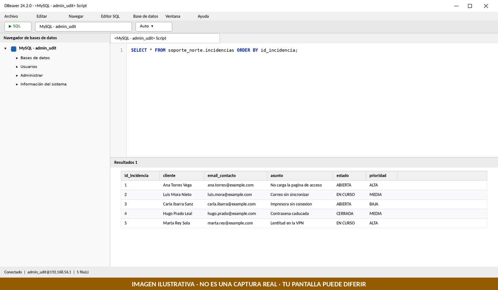

### 10.3 Comprobar primero que `usuario_restringido` NO ve la tabla

**Usuario:** `usuario_restringido` (conexión `MySQL - usuario_restringido`). Comprueba la conexión activa y ejecuta:

```sql
SELECT * FROM soporte_norte.incidencias;
```

**Esperado:** un error `1142` (*SELECT command denied to user 'usuario_restringido'@'...' for table 'incidencias'*).

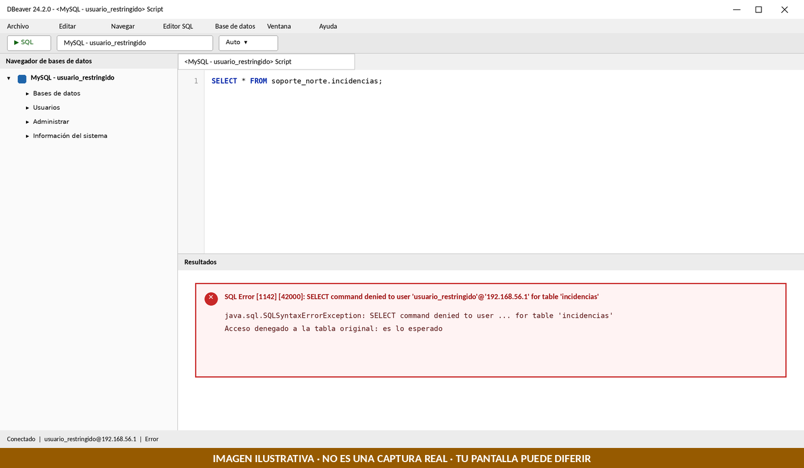

> **Diferencia con Oracle:** Oracle respondía `ORA-00942` ("la tabla no existe") sin decir si existía o no. MySQL dice claramente **"acceso denegado"**.

### 10.4 Crear la vista y dar el permiso

**Usuario:** `admin_udit`. Primero sustituye en el script `<IP_CLIENTE>` por tu IP real (usa `Ctrl + F` en el editor de DBeaver: la pestaña de reemplazar). Después ejecuta con `Alt + X`:

```sql
CREATE OR REPLACE VIEW soporte_norte.v_incidencias_consulta AS
  SELECT id_incidencia, asunto, estado, prioridad
  FROM soporte_norte.incidencias;

GRANT SELECT ON soporte_norte.v_incidencias_consulta TO 'usuario_restringido'@'<IP_CLIENTE>';
```

| Sentencia | Qué hace |
|---|---|
| `CREATE OR REPLACE VIEW ... AS SELECT ...` | Crea (o recrea) una vista con solo 4 columnas: sin `cliente` ni `email_contacto`. |
| `GRANT SELECT ON ...v_incidencias_consulta TO 'usuario_restringido'@'IP'` | Permite a esa cuenta leer la vista, y solo la vista. |

**Esperado:** sin errores.

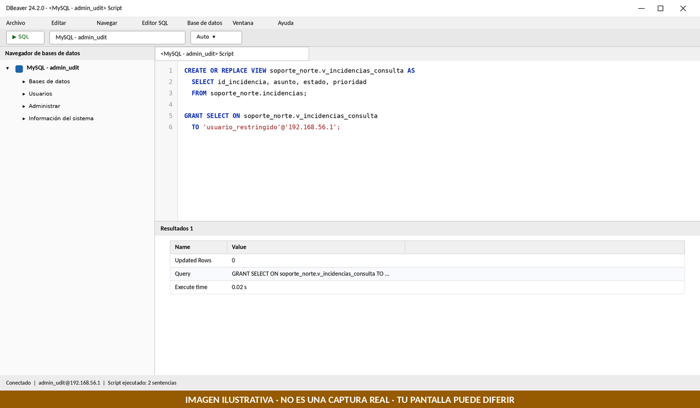

### 10.5 Las tres pruebas con `usuario_restringido`

**Usuario:** `usuario_restringido`. Ejecuta **una a una** con `Ctrl + Enter`:

```sql
SELECT * FROM soporte_norte.v_incidencias_consulta ORDER BY id_incidencia;
SELECT email_contacto FROM soporte_norte.v_incidencias_consulta;
SELECT * FROM soporte_norte.incidencias;
```

| Consulta | Qué demuestra | Esperado |
|---|---|---|
| `SELECT * FROM ...v_incidencias_consulta` | La cuenta lee lo que la vista expone | 5 filas, 4 columnas |
| `SELECT email_contacto FROM ...v_incidencias_consulta` | Esa columna no existe en la vista | Error `1054`: *Unknown column 'email_contacto'* |
| `SELECT * FROM soporte_norte.incidencias` | Sigue sin acceso a la tabla original | Error `1142`: acceso denegado |

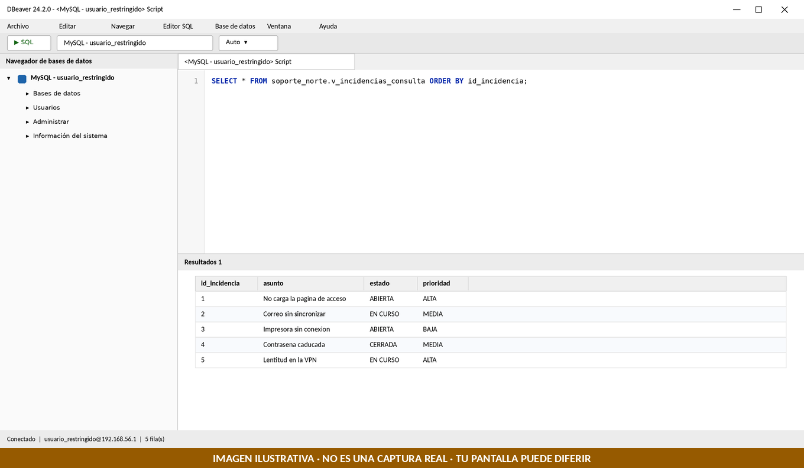

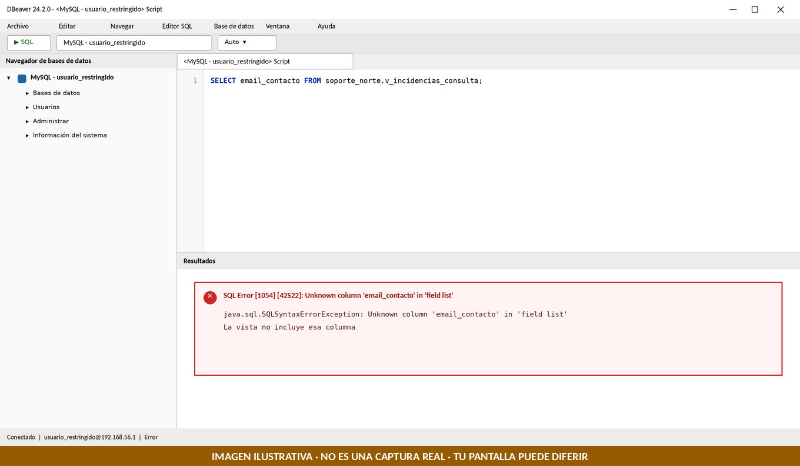

### 10.6 Ver qué permisos tiene

**Usuario:** `usuario_restringido`.

```sql
SHOW GRANTS;
```

**Esperado:** dos líneas: `GRANT USAGE ON *.*` (solo puede conectarse) y `GRANT SELECT ON soporte_norte.v_incidencias_consulta` (puede leer esa vista). Esta idea, "qué privilegios tiene cada cuenta", es la base del **Reto 4**.

✅ **Punto de control 6:** vista legible, `email_contacto` rechazado y tabla original denegada.

---

## 11. Cierre (165-180 min): Oracle frente a MySQL

| Tarea | Oracle | MySQL |
|---|---|---|
| Crear una cuenta | `CREATE USER x IDENTIFIED BY ...` | `CREATE USER 'x'@'host' IDENTIFIED BY ...` |
| Poder iniciar sesión | `GRANT CREATE SESSION` | Se puede conectar si la cuenta existe (privilegio `USAGE`) |
| Crear una base de datos | Un esquema por usuario | `CREATE DATABASE` |
| Nombre cualificado | `esquema.objeto` | `basedatos.objeto` |
| Permiso sobre la vista | `GRANT SELECT ON esquema.vista TO usuario` | `GRANT SELECT ON bd.vista TO 'usuario'@'host'` |
| Tabla sin permiso | `ORA-00942` | Error `1142` (acceso denegado) |
| Columna inexistente | `ORA-00904` | Error `1054` |
| Sinónimos | Sí | No existen |

**Lo que viene:** la semana próxima harás el **Reto 4 (evaluable)** con este mismo entorno: identificar privilegios y agruparlos. Hoy no se resuelve.

## 12. Errores frecuentes

| Síntoma o error | Causa probable | Qué hacer |
|---|---|---|
| El MSI no se ejecuta o pide un runtime | Falta Visual C++ Redistributable | Instálalo y repite el MSI |
| El servicio MySQL está `Stopped` o no arranca | Configuración incompleta, puerto 3306 ocupado, falta de memoria | Reinicia el servicio; si falla, mira **Visor de eventos** y avisa al profesor |
| `Test-NetConnection` da `False` antes de la regla | Normal: aún no has abierto el puerto | Sigue en 8.2 y 8.3 |
| `Test-NetConnection` da `False` después de la regla | Servicio parado, IP equivocada, IP del Ámbito equivocada u otra regla | Revisa 8.4, por orden |
| `Host '...' is not allowed to connect to this MySQL server` (error 1130) | La cuenta se creó con otro host distinto del real | El mensaje **indica la IP real**: crea la cuenta con esa IP |
| `Access denied for user ...` (error 1045) | Contraseña errónea o `usuario@host` que no coincide | Revisa usuario, contraseña y el host de la cuenta |
| `Public Key Retrieval is not allowed` | Autenticación sin canal seguro | `allowPublicKeyRetrieval=true` en *Driver properties* |
| DBeaver no descarga el driver | PC físico sin internet | Comprueba la conexión de red del PC físico |
| `Communications link failure` o *timeout* | Servicio parado, firewall o IP mal escrita | Repite `Test-NetConnection` antes de culpar a DBeaver |
| `ERROR 1007: database exists` | Repetiste `CREATE DATABASE` | Ya existe; sigue con la tabla |
| `ERROR 1050: table already exists` | Repetiste `CREATE TABLE` | Ya existe; sigue con el siguiente paso |
| `ERROR 1062: Duplicate entry` | Repetiste los `INSERT` | Los datos ya están; no los repitas |
| `ERROR 1064: You have an error in your SQL syntax` | Falta una coma o comilla, o dejaste `<IP_CLIENTE>` sin sustituir | Revisa el texto que indica el error |
| `ERROR 1396: Operation CREATE USER failed` | La cuenta ya existía | No la repitas; verifica con 7.5 |

## 13. Checklist del alumno

- [ ] Tengo anotadas `<IP_SERVIDOR>` e `<IP_CLIENTE>` y he hecho la instantánea
- [ ] MySQL 8.4 está instalado y el servicio está en `Running`
- [ ] Entro con `root` en el cliente `mysql` de la VM y `SELECT VERSION();` responde
- [ ] Existen `admin_udit` y `usuario_restringido` con mi IP en `host`
- [ ] El firewall solo abre el 3306 a mi IP y `Test-NetConnection` da `True`
- [ ] DBeaver conecta con `admin_udit` y con `usuario_restringido`
- [ ] Creé `soporte_norte`, la tabla `incidencias` y sus 5 filas
- [ ] `usuario_restringido` recibe el error 1142 sobre la tabla
- [ ] La vista `v_incidencias_consulta` funciona y `email_contacto` da el error 1054
- [ ] `SHOW GRANTS;` muestra `USAGE` y el `SELECT` sobre la vista
- [ ] No he escrito ninguna contraseña en capturas ni archivos

> Guarda tus capturas si quieres repasar. **Haz un commit en tu repositorio** al terminar, y **no incluyas contraseñas**.
